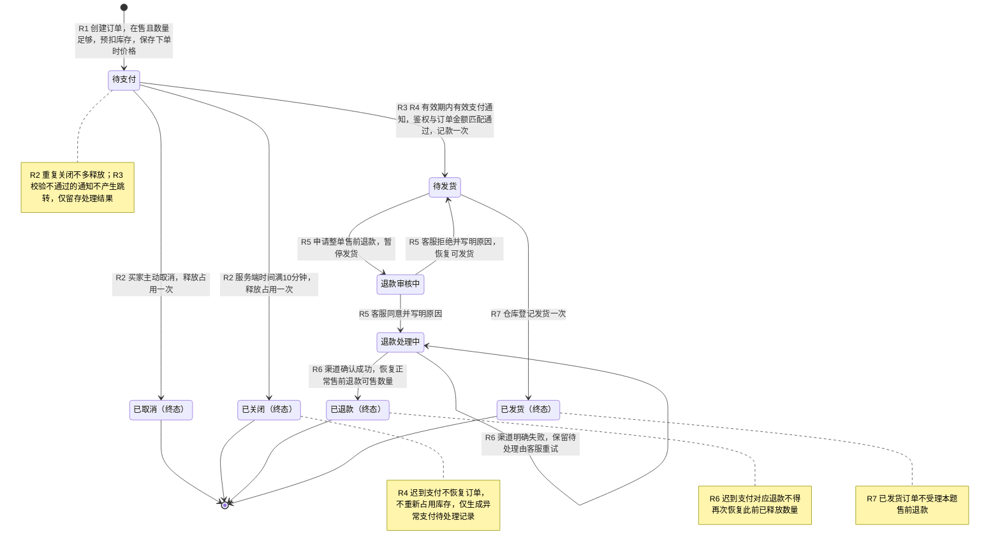

# 题目 01：小型电商的订单交易、发货与售前退款 —— 原型设计文档

| 项 | 内容 |
| --- | --- |
| 文档类型 | 原型设计阶段交付物（页面说明文档） |
| 版本 | v1.0 |
| 上游文档 | 《题目01-小型电商订单交易发货与售前退款-需求文档.md》v1.0 |
| 题面来源 | 《Go 项目业务场景题》题目 01「原型、Skill 与单日边界」及「一、所有题目共同适用的要求」第 2 条、第 8 条、第 9 条 |
| 原型形态 | **轻量可操作 HTML 原型**；本文档只说明页面结构、按钮、展示字段、状态分支与提示文案 |
| 视觉要求 | **不做 CSS 美化**，仅保留基础页面结构、按钮、文本展示与可读性排版；不引入样式框架 |
| 文档边界 | **不产出前端 HTML 代码**、不产出接口设计、表结构设计或任何实现代码。第 4 章 Mermaid 为文档图示，非前端代码 |
| 规则依据 | 严格遵循题面 8 条业务规则与 5 组必须演示场景；题面未明确事项沿用需求文档第 8 章假设清单（A-xx） |
| 编号约定 | 视图 `V-01~V-08`、共用组件 `C-xx`、共用子区 `S-01`、提示文案 `M-xx`；状态跳转沿用需求文档 `T-xx / F-xx` |

---

## 1. 原型整体说明

### 1.1 技术选择

| 编号 | 项 | 选择 |
| --- | --- | --- |
| PT-01 | 页面形态 | 轻量可操作 HTML 原型，服务端返回页面；表单提交 + 页面刷新查询即可完成全部演示 |
| PT-02 | 视觉 | **不做 CSS 美化**；只用基础结构（区块、列表行、文本、输入框、按钮）区分信息与操作 |
| PT-03 | 前端 | 不引入前端框架、不构建 SPA、不使用长连接 / WebSocket；页面状态来自服务端查询结果 |
| PT-04 | 身份 | 预置账号 + 服务端会话识别；顶部身份条提供「切换当前预置身份」仅用于演示。**角色身份不得由请求中的用户编号决定**，页面不得提供改编号越权的入口 |
| PT-05 | 数据 | 所有展示字段来自数据库持久化结果；**不得用静态页面、写死成功结果或文档说明代替**；服务重启后结果仍可查询 |
| PT-06 | 结果反馈 | 每个页面都有「操作结果区」，每次操作必须展示成功或失败原因（文案统一取第 3.3 节 M-xx） |
| PT-07 | 时间 | 超时判断与剩余时间以**服务端时间**为准；演示可用可配置教学时钟缩短 10 分钟，页面必须显示并注明缩短值；测试与线上演示使用相同业务规则（A-01、A-02） |
| PT-08 | 第三方 | 模拟支付渠道为可控 HTTP 模拟服务，触发入口在客服工作台共用子区 S-01；页面须显著标注「模拟服务」，不得表现为真实第三方（A-19） |
| PT-09 | 状态口径 | 页面状态标签统一使用需求文档第 4 章的 8 个订单状态名与 4 个终态（A-08） |
| PT-10 | 覆盖范围 | 覆盖题面要求的商品与订单页、仓库待发货页、客服退款及异常支付页、运营核查页；本原型拆为 8 个视图，可合并到少量标签页（A-17） |

### 1.2 角色与页面列表（共 4 类角色、8 个视图）

| 角色 | 预置账号 | 视图编号 | 页面名称 | 页面归属 |
| --- | --- | --- | --- | --- |
| 买家 | `buyer01`、`buyer02`、`buyer03` | V-01 | 商品浏览页 | 买家页面 |
| 买家 | 同上 | V-02 | 我的订单列表 & 详情页（含退款申请按钮） | 买家页面 |
| 运营 | `ops01` | V-03 | 商品管理页 | 运营页面 |
| 运营 | 同上 | V-04 | 运营对账核查汇总页 | 运营页面 |
| 仓库 | `wh01` | V-05 | 待发货订单列表 | 仓库工作台 |
| 仓库 | 同上 | V-06 | 发货录入表单 | 仓库工作台 |
| 客服 | `cs01` | V-07 | 退款审核列表 | 客服工作台 |
| 客服 | 同上 | V-08 | 迟到支付异常处理列表 | 客服工作台 |

**角色计数说明**：模拟支付渠道是题面第 5 个参与角色，但**不设独立角色页面**，其触发入口为客服工作台共用子区 `S-01 模拟支付渠道控制台`（V-07 / V-08 均可切换）。因此原型共 **4 类角色页面**，与需求文档 2.4 一致。

### 1.3 与需求文档角色页面的映射

需求文档第 10 章的 `P-01~P-04` 为 4 个角色页面；本原型按操作场景拆为 8 个视图。两套编号不同，避免混淆。

| 需求文档角色页面 | 拆分后的原型视图 |
| --- | --- |
| P-01 商品与订单页（买家） | V-01 商品浏览页、V-02 我的订单列表 & 详情页 |
| P-02 仓库待发货页（仓库） | V-05 待发货订单列表、V-06 发货录入表单 |
| P-03 客服退款及异常支付页（客服） | V-07 退款审核列表、V-08 迟到支付异常处理列表 |
| P-04 运营核查页（运营） | V-03 商品管理页、V-04 运营对账核查汇总页 |

### 1.4 共用组件与共用子区

| 编号 | 名称 | 说明 | 出现位置 |
| --- | --- | --- | --- |
| C-01 | 顶部身份条 | 显示当前角色 / 账号；提供演示身份切换；显示演示教学时钟说明（若缩短） | 全部 8 个视图 |
| C-02 | 操作结果区 | 展示本次操作的成功 / 失败结论与 M-xx 文案；不得留空、不得写死成功 | 全部 8 个视图 |
| C-03 | 订单状态标签 | 统一显示 8 个订单状态之一，终态标注「终态」 | V-02、V-04、V-05、V-06、V-07、V-08 |
| C-04 | 视图切换条 | 切换同一角色下的两个视图，以及切换到本角色可访问的其他视图 | 全部 8 个视图 |
| C-05 | 只读审计流水区 | 按订单显示状态变更时间、变更前 / 后状态、操作角色、原因；**只读** | V-04 |
| S-01 | 模拟支付渠道控制台 | 选择通知类型（正常支付成功、重复支付通知、迟到支付成功、退款成功、退款失败、验签失败、金额不符、未知订单）+ 目标订单 + 「触发」按钮；显示「模拟服务」标识 | V-07、V-08 共用子区，非独立页面 |

### 1.5 页面状态取值口径

| 维度 | 取值 |
| --- | --- |
| 订单主状态 | 待支付、待发货、退款审核中、退款处理中、已取消（终态）、已关闭（终态）、已退款（终态）、已发货（终态） |
| 退款状态 | 无申请、审核中、处理中、渠道失败待重试、退款成功、已拒绝 |
| 异常支付状态 | 待处理、已核实、已发起退款、退款成功、退款失败 |
| 支付通知处理结果 | 鉴权通过 / 鉴权失败；订单匹配 / 未知订单；金额匹配 / 金额不符；渠道交易号可用 / 已占用 |
| 库存占用状态 | 已预扣、已释放、已恢复、未恢复（迟到支付退款） |
| 商品状态 | 在售、下架；当前可售数量、已占用数量 |

---

## 2. 页面说明

> 每个视图统一从「用途 / 可见角色、页面组件、展示字段、按钮操作、状态分支展示、异常提示文案」六个维度说明。所有页面均含 C-01、C-02、C-04，下文组件清单中不再重复列出。

### 2.1 V-01 商品浏览页（买家）

**用途 / 可见角色**：浏览在售商品、选择 1 种商品并输入数量 1 或 2 件提交下单；仅买家可见，本页不展示任何他人订单数据。

**页面组件**

1. 商品列表区：每个商品一行，展示商品字段与「选择该商品」入口；2 个预置商品固定展示。
2. 下单区：已选商品（单选，来自商品列表行）、数量输入框（文本 / 数字，只允许 1 或 2）、应付金额展示（分 = 单价 × 数量，仅展示计算口径）、「提交下单」按钮。
3. 下单结果区：显示订单编号、商品、数量、金额（分）、状态「待支付」、待支付剩余时间，以及跳转 V-02 的入口。
4. 演示时钟说明区：若缩短 10 分钟，显示缩短值并注明测试与线上演示规则一致（M-21）。

**展示字段**

| 字段 | 说明 |
| --- | --- |
| 商品标识 / 名称 | 预置 2 个商品 |
| 单价（分） | 活动商品固定 10000 分 |
| 可售数量 | 实时来自持久化结果，随预扣 / 释放 / 恢复变化 |
| 在售状态 | 在售 / 下架 |
| 已选商品、数量 | 一单仅 1 种商品，数量 1 或 2 |
| 应付金额（分） | 单价 × 数量；不含运费和优惠 |
| 下单结果 | 订单编号、金额（分）、状态、剩余时间 |

**按钮操作**

| 按钮 | 显示条件 | 动作 | 成功结果 | 失败提示 |
| --- | --- | --- | --- | --- |
| 选择该商品 | 始终 | 选中单一商品 | 下单区显示已选商品 | M-04 |
| 刷新商品 | 始终 | 重新查询在售与可售数量 | 刷新列表 | — |
| 提交下单 | 始终显示（便于演示缺货与并发抢单失败分支），由服务端校验 | 创建订单 + 预扣库存 | 跳转 / 展示下单结果，状态待支付 | M-01、M-02、M-03、M-04 |
| 前往我的订单 | 始终 | 跳转 V-02 | — | — |

**不同业务状态下展示内容**

| 商品 / 场景状态 | 列表展示 | 下单区 | 提交下单结果 |
| --- | --- | --- | --- |
| 在售、可售充足 | 单价、可售数量、在售 | 可编辑、按钮可用 | 创建待支付订单，显示剩余时间 |
| 在售、可售不足 | 显示「可售数量不足」 | 按钮仍显示 | M-02，不产生订单、库存不变 |
| 在售、可售为 0（并发抢单后） | 显示「可售 0」 | 按钮仍显示 | M-02 |
| 商品下架 | 显示「未上架」 | 按钮仍显示 | M-01 |
| 数量填 0 / 3 / 负数 | — | 按钮仍显示 | M-03 |
| 一次选择两种商品 | — | — | M-04 |
| 订单创建成功 | — | 结果区展示订单编号与金额 | 状态「待支付」，剩余 10 分钟（或注明的缩短值） |

**异常提示文案**：M-01、M-02、M-03、M-04、M-20、M-21。

---

### 2.2 V-02 我的订单列表 & 详情页（买家）

**用途 / 可见角色**：查询本人订单、发起付款、主动取消、对已付款未发货订单**申请整单售前退款**、查看退款结果与运单；仅买家可见，**仅展示本人订单**。

**页面组件**

1. 订单列表区：按状态筛选（全部 / 待支付 / 待发货 / 退款中 / 已发货 / 已退款 / 已取消 / 已关闭），每行一个本人订单。
2. 订单详情区：选中订单后展示商品、价格快照、金额、状态与时间。
3. 收款信息子区、退款信息子区、发货信息子区、异常提示子区。
4. 操作按钮区：按订单状态显隐（见下表与 3.1 总矩阵）。
5. 操作结果区：展示 M-xx 文案。

**展示字段**

| 子区 | 字段 |
| --- | --- |
| 订单 | 订单编号、商品名称、下单时单价（分）、数量、应付金额（分）、订单状态、下单时间、待支付剩余时间 |
| 收款 | 支付结果、渠道交易号、收款时间 |
| 退款 | 退款状态、退款金额（分）、退款结果、审核原因、渠道失败原因、重试结果 |
| 发货 | 承运方、运单号、发货时间 |
| 异常 | 迟到支付异常提示、操作拒绝原因 |

**按钮操作**

| 按钮 | 显示条件 | 动作 | 成功结果 | 失败提示 |
| --- | --- | --- | --- | --- |
| 查看详情 / 刷新 | 始终 | 重新查询本人订单 | 展示持久化结果 | M-20 |
| 发起付款 | 仅待支付 | 向模拟渠道发起付款，等待回调 | 状态转待发货 | M-05、M-06 |
| 取消订单 | 仅待支付 | 主动取消，释放占用一次 | 状态转已取消 | M-05、M-10 |
| 申请整单退款 | 仅待发货 | 提交整单售前退款申请 | 状态转退款审核中，发货暂停 | M-05、M-11 |
| 查看退款结果 | 退款处理中 / 已退款 | 查询退款状态与结果 | 显示退款金额与结果 | M-05 |
| 查看运单 | 仅已发货 | 查询承运方与运单号 | 显示运单 | — |

**不同业务状态下展示内容（显示 / 隐藏按钮）**

| 订单状态 | 展示内容 | 显示按钮 | 隐藏按钮 |
| --- | --- | --- | --- |
| 待支付 | 应付金额（分）、剩余时间、库存已占用提示 | 发起付款、取消订单 | 申请整单退款、查看退款结果、查看运单 |
| 待发货 | 支付结果、渠道交易号、收款时间 | 申请整单退款、查看详情 | 发起付款、取消订单、查看运单 |
| 退款审核中 | 「退款申请审核中，发货已暂停」、申请时间 | 查看详情 | 发起付款、取消订单、申请整单退款、查看运单 |
| 退款处理中 | 退款状态、渠道退款结果；失败时显示 M-08 | 查看退款结果、查看详情 | 发起付款、取消订单、申请整单退款、查看运单 |
| 已取消（终态） | 「已主动取消，占用已释放」 | 查看详情 | 发起付款、取消订单、申请整单退款 |
| 已关闭（终态） | 「超时关闭（服务端时间满 10 分钟），占用已释放」；若存在迟到支付异常，显示 M-09「已转客服异常支付待处理，订单不会恢复」 | 查看详情 | 发起付款、取消订单、申请整单退款 |
| 已退款（终态） | 退款金额（分）、退款结果、恢复的可售数量 | 查看退款结果、查看详情 | 发起付款、取消订单、申请整单退款、查看运单 |
| 已发货（终态） | 承运方、运单号、发货时间 | 查看运单、查看详情 | 发起付款、取消订单、申请整单退款（点击给出 M-11） |

**异常提示文案**：M-05、M-06、M-08、M-09、M-10、M-11、M-20、M-21、M-26。

---

### 2.3 V-03 商品管理页（运营）

**用途 / 可见角色**：维护商品上下架、售价与可售数量；仅运营可见。用于演示「运营上架 → 买家购买」及「后续上下架和价格调整不改变已有订单金额」。

**页面组件**

1. 商品列表区：2 个预置商品各一行，展示商品与库存字段。
2. 维护区：选中商品后，售价（分）输入框、可售数量输入框、上架 / 下架按钮、保存按钮。
3. 维护记录区：显示操作人、时间、原因（只读）。
4. 提示区：保存后固定展示 M-12（已有订单金额不受影响）。
5. 跳转区：前往 V-04 运营对账核查汇总页。

**展示字段**

| 字段 | 说明 |
| --- | --- |
| 商品标识 / 名称 | 预置 2 个商品 |
| 单价（分） | 可维护；活动商品初始 10000 分 |
| 初始可售数量 / 当前可售数量 / 已占用数量 | 库存守恒口径（A-10） |
| 在售状态、上架 / 下架时间 | 只读展示 |
| 最近维护记录 | 操作人、时间、原因 |

**按钮操作**

| 按钮 | 显示条件 | 动作 | 成功结果 | 失败提示 |
| --- | --- | --- | --- | --- |
| 上架 | 商品下架时显示 | 置为在售 | 买家页可购买 | — |
| 下架 | 商品在售时显示 | 置为下架 | 买家页显示「未上架」 | — |
| 保存售价 / 可售数量 | 选中商品后显示 | 维护商品资料 | 提示 M-12；已有订单金额不变 | M-13 |
| 刷新 / 前往对账核查 | 始终 | 查询 | — | — |

**不同业务状态下展示内容**

| 商品状态 | 展示内容 | 显示按钮 | 隐藏按钮 |
| --- | --- | --- | --- |
| 在售 | 单价、当前可售、已占用、在售 | 下架、保存 | 上架 |
| 下架 | 同上 + 「未上架」 | 上架、保存 | 下架 |
| 调价 / 改可售数量后 | 显示 M-12「已有订单的下单时商品与价格不受影响」 | 保存、刷新 | — |
| 并发抢单期间 / 可售为 0 | 显示当前可售 0、已占用明细 | 刷新 | 「清除异常记录」类入口（不提供） |
| 存在异常支付记录 | 异常记录仍在 V-04 可查 | 刷新 | 任何改写订单状态 / 删除异常记录的入口 |

**异常提示文案**：M-12、M-13、M-14、M-21。

---

### 2.4 V-04 运营对账核查汇总页（运营）

**用途 / 可见角色**：按订单查询收款、退款、发货和异常处理记录，查看商品可售数量、已收款及已退款汇总；仅运营可见。订单状态在本页**只读**。

**页面组件**

1. 汇总区：商品可售数量、已收款合计（分）、已退款合计（分）、异常记录数、待处理数。
2. 订单查询区：按订单编号查询，展示订单主信息。
3. 逐笔记录区：分「收款 / 退款 / 发货 / 异常处理」四类，逐笔展示。
4. 异常待处理区：显示待处理异常与渠道退款失败记录。
5. 只读审计流水区（C-05）：状态变更全过程。
6. 跳转区：前往 V-03 商品管理页。

**展示字段**

| 子区 | 字段 |
| --- | --- |
| 汇总 | 商品可售数量、已收款合计（分）、已退款合计（分）、异常记录数、待处理数 |
| 订单 | 编号、买家、商品、数量、金额（分）、状态、创建 / 支付 / 关闭 / 发货 / 退款时间 |
| 逐笔记录 | 记录类型、金额（分）、时间、结果、原因 |
| 异常 | 异常类型、订单编号、渠道交易号、处理结果、**是否恢复库存** |
| 审计 | 变更时间、变更前状态、变更后状态、操作角色、操作原因 |

**按钮操作**

| 按钮 | 显示条件 | 动作 | 结果 |
| --- | --- | --- | --- |
| 查询订单 / 刷新汇总 | 始终 | 重新查询持久化结果 | 汇总与逐笔记录一致 |
| 查看逐笔记录 / 异常详情 | 有记录时 | 展开明细 | 显示金额、时间、结果、原因 |
| 查看审计流水 | 始终 | 只读展示 C-05 | 不允许编辑 / 删除 |
| 修改订单状态、删除异常记录 | **不提供**（规则 8） | — | — |

**不同业务状态下展示内容**

| 场景 / 状态 | 页面展示 |
| --- | --- |
| 正常成交（已发货） | 已收款 20000 分、已退款 0 分、可售 3 件、发货记录 1 条、异常 0 条；逐笔与汇总一致 |
| 待支付 / 已取消 / 已关闭 | 显示订单终态与库存释放记录；已关闭且存在迟到支付时显示 M-15、M-17 |
| 退款处理中 / 渠道失败 | 显示 M-16「退款失败待处理」，待处理数 +1，失败原因可见 |
| 已退款 | 显示退款金额（分）、恢复的可售数量；收款与退款分列，不混为已收款 |
| 迟到支付 | 订单仍为**已关闭终态**；异常支付记录 1 条、退款 1 条；显示「本单未产生库存恢复」「无重复释放、无重复退款」（M-17、M-26） |
| 存在待处理异常 | 异常待处理区常显；异常记录不可消失（M-14） |

**异常提示文案**：M-13、M-14、M-15、M-16、M-17、M-21、M-26。

---

### 2.5 V-05 待发货订单列表（仓库）

**用途 / 可见角色**：查询可发货订单；仅仓库可见。只有合法待发货订单可作为发货对象。

**页面组件**

1. 筛选区：可发货 / 暂停发货 / 已发货 / 全部。
2. 订单列表区：每行展示订单字段、是否可发货、暂停发货原因，以及「登记发货」入口（跳 V-06）。
3. 发货结果区：显示已登记的承运方、运单号、发货时间。
4. 操作结果区：展示 M-xx 文案。

**展示字段**

| 字段 | 说明 |
| --- | --- |
| 订单编号、商品名称、数量、金额（分） | 订单摘要 |
| 订单状态、付款时间 | 判定是否可发货 |
| 是否可发货、暂停发货原因 | 退款审核中 / 退款处理中显示「暂停发货」 |
| 承运方、运单号、发货时间 | 已登记后只读展示 |
| 操作拒绝原因 | M-xx |

**按钮操作**

| 按钮 | 显示条件 | 动作 | 成功结果 | 失败提示 |
| --- | --- | --- | --- | --- |
| 查询 / 刷新 | 始终 | 重新查询可发货订单 | 刷新列表 | — |
| 登记发货 | **仅合法待发货行**显示 | 跳转 V-06 | 打开发货录入表单 | M-18 |
| 查看发货结果 | 已发货行 | 只读展示 | 显示运单 | — |

**不同业务状态下展示内容（显示 / 隐藏按钮）**

| 订单状态 | 列表展示 | 「登记发货」按钮 |
| --- | --- | --- |
| 待支付 | 「未支付，不可发货」；不进入可发货列表 | 隐藏 |
| 待发货 | 付款时间、金额、可发货 | **显示** |
| 退款审核中 | 「暂停发货：退款申请审核中」及原因（M-07） | 隐藏 |
| 退款处理中 | 「暂停发货：退款处理中」及原因（M-07） | 隐藏 |
| 已取消 / 已关闭（终态） | 终态标记、占用已释放；迟到支付异常单不进入可发货列表 | 隐藏 |
| 已退款（终态） | 终态标记、退款结果 | 隐藏 |
| 已发货（终态） | 承运方、运单号、发货时间 | 隐藏；重复登记给 M-19 |

**异常提示文案**：M-07、M-10、M-18、M-19、M-20、M-22。

---

### 2.6 V-06 发货录入表单（仓库）

**用途 / 可见角色**：填写承运方和运单号，为合法待发货订单完成**一次**发货登记；仅仓库可见。

**页面组件**

1. 订单摘要区（只读）：订单编号、商品、数量、金额（分）、当前状态、付款时间。
2. 表单区：承运方文本输入框、运单号文本输入框。
3. 提交区：「提交发货登记」按钮、返回 V-05 按钮、刷新状态按钮。
4. 登记结果区：成功后显示承运方、运单号、发货时间（只读）。
5. 操作结果区：展示 M-xx 文案。

**展示字段**

订单编号、商品名称、数量、金额（分）、订单状态、付款时间、承运方输入、运单号输入、登记结果、发货时间、拒绝原因。

**按钮操作**

| 按钮 | 显示条件 | 动作 | 成功结果 | 失败提示 |
| --- | --- | --- | --- | --- |
| 提交发货登记 | 进入时订单为合法待发货 | 登记一次发货 | 状态转已发货，表单只读 | M-07、M-18、M-19、M-22、M-23 |
| 返回列表 / 刷新状态 | 始终 | 查询最新状态 | 状态变化后按钮自动隐藏 | — |

**不同业务状态下展示内容**

| 场景 / 状态 | 表单 | 按钮 | 提示 |
| --- | --- | --- | --- |
| 待发货（合法） | 可编辑 | 提交显示 | — |
| 提交期间并发产生退款申请 | 锁定为只读 | 提交隐藏 | M-22「本单已进入退款流程，发货未登记；仅形成一种合法业务结果」 |
| 退款审核中 / 退款处理中 | 不可编辑 | 提交隐藏 | M-07 |
| 登记成功（已发货） | 只读，显示运单号与发货时间 | 提交隐藏 | — |
| 重复点击提交 | 只读 | 提交隐藏 | M-19 |
| 已取消 / 已关闭 / 已退款 | 不可编辑 | 提交隐藏 | M-18 |
| 承运方或运单号为空 | 可编辑 | 提交显示 | M-23 |

**异常提示文案**：M-07、M-18、M-19、M-20、M-22、M-23。

---

### 2.7 V-07 退款审核列表（客服）

**用途 / 可见角色**：审核售前退款（同意或拒绝并写明原因）、向模拟渠道发起整单退款、对渠道明确失败的退款重试；仅客服可见。

**页面组件**

1. 筛选区：待审核 / 处理中 / 渠道失败待重试 / 已同意 / 已拒绝 / 已完成。
2. 退款申请列表区：每条申请一行，标注订单状态与「发货已暂停」。
3. 审核表单区：同意 / 拒绝选择、**原因输入框（必填）**、提交按钮。
4. 退款流水区：渠道退款结果、失败原因、重试次数与每次结果。
5. 共用子区 S-01 模拟支付渠道控制台：触发退款成功 / 退款失败等结果。
6. 操作结果区：展示 M-xx 文案。

**展示字段**

| 字段 | 说明 |
| --- | --- |
| 订单编号、买家、退款金额（分） | 整单全额，等于订单实收金额 |
| 申请时间、订单状态、退款状态 | 关联状态机 |
| 渠道退款结果、失败原因 | 来自模拟渠道 |
| 审核人、审核原因 | 同意或拒绝均必填 |
| 重试次数与每次结果 | 每次重试留痕（A-13） |
| 是否恢复库存 | 正常售前退款显示「已恢复」；迟到支付对应退款显示「不恢复」 |

**按钮操作**

| 按钮 | 显示条件 | 动作 | 成功结果 | 失败提示 |
| --- | --- | --- | --- | --- |
| 同意并填写原因 | 退款审核中 | 同意 + 原因 | 转退款处理中 | M-24、M-10 |
| 拒绝并填写原因 | 退款审核中 | 拒绝 + 原因 | 回待发货，允许继续发货 | M-24、M-10 |
| 发起退款 | 退款处理中 | 向模拟渠道发起整单退款 | 生成退款流水 | M-10、M-25 |
| 重试退款 | 渠道明确失败、待处理 | 重新发起 | 每次重试留痕 | M-08、M-10 |
| 查询 / 刷新 | 始终 | 重新查询 | — | — |
| S-01 触发 | 始终（标注「模拟服务」） | 触发退款成功 / 失败等 | 页面按结果分支展示 | — |

**不同业务状态下展示内容（显示 / 隐藏按钮）**

| 退款 / 订单状态 | 展示内容 | 显示按钮 | 隐藏按钮 |
| --- | --- | --- | --- |
| 退款审核中 | 「发货已暂停」、申请时间、退款金额 | 同意、拒绝 | 发起退款、重试退款 |
| 退款处理中（已同意） | 审核人、审核原因、渠道处理结果 | 发起退款 | 同意、拒绝、重试退款 |
| 渠道明确失败 | 「失败待重试」、失败原因、重试次数（M-08） | 重试退款 | 同意、拒绝 |
| 渠道确认成功（已退款） | 退款结果、退款金额、恢复的可售数量 | 查询 | 同意、拒绝、发起退款、重试退款 |
| 已拒绝 | 拒绝原因 +「订单已恢复可发货」 | 查询 | 同意、拒绝、重试退款 |
| 已发货订单的退款申请 | 不出现在列表；越权申请给 M-11 | — | 全部操作按钮 |
| 迟到支付对应退款 | 单独标注 M-26「本退款不恢复此前已释放数量」 | 查询、重试（如失败） | 同意、拒绝 |

**异常提示文案**：M-08、M-10、M-11、M-16、M-20、M-24、M-25、M-26。

---

### 2.8 V-08 迟到支付异常处理列表（客服）

**用途 / 可见角色**：从异常支付待处理列表发现迟到支付、核实并**记录原因**、发起退款；同时查询支付通知处理结果（鉴权、订单匹配、金额匹配）；仅客服可见。

**页面组件**

1. 筛选区：待处理 / 已核实 / 已发起退款 / 退款成功 / 退款失败。
2. 异常支付列表区：每条异常一行，显示订单当前状态（固定为已关闭终态）。
3. 异常详情区：通知到达时间、订单关闭时间、渠道交易号、异常类型。
4. 核实处理区：**处理原因输入框（必填）**、「核实并记录原因」按钮、「发起退款」按钮。
5. 支付通知处理结果区：逐条展示鉴权结果 / 订单匹配结果 / 金额匹配结果 / 处理结论（含验签失败、金额不符、未知订单、交易号重复），**不进入异常支付待处理列表**。
6. 共用子区 S-01 模拟支付渠道控制台：触发迟到支付成功通知、重复通知、验签失败、金额不符、未知订单等。
7. 操作结果区：展示 M-xx 文案。

**展示字段**

| 字段 | 说明 |
| --- | --- |
| 异常编号、渠道交易号、订单编号 | 定位异常 |
| 通知到达时间、订单关闭时间 | 证明「关闭后到达」 |
| 异常类型、处理结果 | 迟到支付 / 其他校验失败 |
| 订单当前状态 | **始终显示「已关闭（终态）」** |
| 核实人、处理原因 | 客服必须记录（规则 4） |
| 关联退款结果、重试结果 | 与 V-07 共用退款流水 |
| 是否恢复库存 | 迟到支付退款固定显示「**不恢复**」 |
| 通知处理结果 | 通知编号、鉴权结果、订单匹配结果、金额匹配结果、处理结论 |

**按钮操作**

| 按钮 | 显示条件 | 动作 | 成功结果 | 失败提示 |
| --- | --- | --- | --- | --- |
| 查看详情 / 刷新 | 始终 | 查询异常与通知结果 | — | — |
| 核实并记录原因 | 待处理 | 保存核实人与原因 | 状态转已核实 | M-24、M-15 |
| 发起退款 | 已核实 / 退款失败 | 向模拟渠道发起退款 | 生成退款流水 | M-10、M-26 |
| 重试退款 | 关联退款明确失败 | 重新发起 | 每次重试留痕 | M-08 |
| S-01 触发 | 始终（标注「模拟服务」） | 触发迟到回调 / 重复回调 / 校验失败通知 | 页面按结果分支展示 | — |

**不同业务状态下展示内容（显示 / 隐藏按钮）**

| 异常 / 退款状态 | 展示内容 | 显示按钮 | 隐藏按钮 |
| --- | --- | --- | --- |
| 待处理 | M-09「订单已关闭，支付成功通知迟到，不能恢复订单或重新占用库存」；订单状态为已关闭终态 | 核实并记录原因、发起退款 | 重试退款 |
| 已核实 | 核实人、处理原因、通知到达时间与关闭时间 | 发起退款 | 核实并记录原因 |
| 已发起退款 | 关联退款流水、退款金额 | 查询 | 发起退款（防重复退款） |
| 退款成功 | 退款结果；标注「本单未产生库存恢复」、M-26 | 查询 | 发起退款、核实并记录原因 |
| 退款失败 | 失败原因、M-08、M-16 | 重试退款 | 核实并记录原因 |
| 验签失败 / 金额不符 / 未知订单 / 交易号重复 | 在「支付通知处理结果区」显示各自结论；订单状态不变；**不生成异常支付待处理记录** | 查询 | 发起退款 |
| 重复支付通知 | 显示 M-25「已幂等处理，未重复记款」；订单不跳转 | 查询 | 发起退款 |

**异常提示文案**：M-08、M-09、M-10、M-14、M-15、M-16、M-20、M-25、M-26、M-27、M-28、M-29、M-30。

---

## 3. 状态说明

### 3.1 订单状态 × 按钮显隐总矩阵

「显示」= 按钮可见且可点；「隐藏」= 不渲染；「只读」= 可见但不可提交；「—」= 该页面不承载此操作。

| 按钮（所在视图） | 待支付 | 待发货 | 退款审核中 | 退款处理中 | 已取消 终态 | 已关闭 终态 | 已退款 终态 | 已发货 终态 |
| --- | --- | --- | --- | --- | --- | --- | --- | --- |
| 发起付款（V-02） | 显示 | 隐藏 | 隐藏 | 隐藏 | 隐藏 | 隐藏 | 隐藏 | 隐藏 |
| 取消订单（V-02） | 显示 | 隐藏 | 隐藏 | 隐藏 | 隐藏 | 隐藏 | 隐藏 | 隐藏 |
| 申请整单退款（V-02） | 隐藏 | **显示** | 隐藏 | 隐藏 | 隐藏 | 隐藏 | 隐藏 | 隐藏（越权点击给 M-11） |
| 查看退款结果（V-02） | 隐藏 | 隐藏 | 隐藏 | 显示 | 隐藏 | 隐藏 | 显示 | 隐藏 |
| 查看运单（V-02） | 隐藏 | 隐藏 | 隐藏 | 隐藏 | 隐藏 | 隐藏 | 隐藏 | 显示 |
| 登记发货入口（V-05） | 隐藏 | **显示** | 隐藏 | 隐藏 | 隐藏 | 隐藏 | 隐藏 | 隐藏 |
| 提交发货登记（V-06） | 隐藏 | **显示** | 只读（M-07） | 只读（M-07） | 隐藏 | 隐藏 | 隐藏 | 隐藏（重复给 M-19） |
| 同意 / 拒绝退款（V-07） | — | — | **显示** | 隐藏 | — | — | 隐藏 | — |
| 发起退款 / 重试退款（V-07） | — | — | 隐藏 | **显示**（失败后可重试） | — | — | 隐藏 | — |
| 核实并记录原因 / 发起退款（V-08） | — | — | — | — | — | **仅异常支付待处理时显示**，订单状态恒为已关闭 | — | — |
| 查询订单 / 查看审计流水（V-04） | 只读 | 只读 | 只读 | 只读 | 只读 | 只读 | 只读 | 只读 |

**不随订单状态变化的分支**：

- V-01 提交下单按钮**始终显示**，按「商品是否在售 / 可售数量是否足够 / 数量是否合法」分支，便于演示并发抢单与缺货弃单。
- V-03 上架 / 下架按钮按**商品在售状态**互斥显隐。
- V-04 为只读核查页，不提供任何改写订单状态的按钮（规则 8）。
- V-08 迟到支付异常列表与订单终态无关，恒显示「订单已关闭（终态）」。

### 3.2 异常场景在各页面的展示

| 异常场景 | 主展示页面 | 关联页面 | 页面展示内容 | 提示文案 | 订单状态是否跳转 |
| --- | --- | --- | --- | --- | --- |
| 迟到支付 | V-08 | V-02、V-04 | 通知到达时间 / 订单关闭时间、订单仍为已关闭终态、异常支付记录、客服处理原因、关联退款结果、「本单未产生库存恢复」 | M-09、M-15、M-17、M-26 | **否**，仅生成异常支付待处理记录 |
| 渠道退款失败 | V-07 | V-02、V-04、V-08 | 「失败待重试」、失败原因、重试次数与每次结果、待处理数 +1 | M-08、M-16 | **否**，停留退款处理中 |
| 退款与发货并发 | V-06、V-05 | V-07、V-04 | 发货被拒 / 表单只读、仅一种合法结果、后到者明确拒绝 | M-22、M-07 | 仅一条分支生效 |
| 重复支付 / 退款通知 | V-08 通知处理结果区 | V-04 | 「已幂等处理，未重复记款 / 未重复退款」、收款记录条数不变 | M-10、M-25 | **否** |
| 验签失败 / 金额不符 / 未知订单 / 交易号重复 | V-08 通知处理结果区 | V-04 | 逐条显示鉴权 / 订单匹配 / 金额匹配结论与处理结论，可查询 | M-27、M-28、M-29、M-30 | **否** |
| 并发抢单 / 缺货弃单 | V-01 | V-03、V-04 | 可售数量实时变化、被拒原因、释放后可再次购买、库存守恒 | M-02、M-06 | 仅成功下单产生待支付 |
| 重复关闭 / 重复发货 / 重复审核 | V-02、V-06、V-07 | V-04 | 第二次操作明确拒绝，业务记录不增加 | M-10、M-19 | **否** |
| 越权查看或处理他人订单 | 全部视图 | — | 明确拒绝、不返回他人数据、留痕 | M-20 | **否** |
| 演示教学时钟缩短 | 全部视图（C-01） | — | 显示缩短值并注明测试与线上演示规则一致 | M-21 | 不改变规则 |

### 3.3 异常提示文案总表（M-xx）

| 编号 | 文案 | 触发场景 | 主要出现页面 | 题面依据 |
| --- | --- | --- | --- | --- |
| M-01 | 商品未上架，不能购买 | 购买下架商品 | V-01 | 规则 1 |
| M-02 | 可售数量不足，下单失败 | 库存不足、并发抢单落败、缺货弃单 | V-01、V-03、V-04 | 规则 1、场景「缺货与弃单」 |
| M-03 | 每单数量只能是 1 或 2 件 | 数量 0 / 3 / 负数 | V-01 | 题面数量约束 |
| M-04 | 一单只能购买一种商品 | 一次选择多种商品 | V-01 | 题面「每单仅购买一种商品」 |
| M-05 | 该订单状态不允许此操作 | 非法状态跳转 | V-02、V-05、V-06 | 状态机 F-05 / F-07 |
| M-06 | 订单已超时关闭（服务端时间满 10 分钟），占用已释放 | 超时关闭、关闭后付款 | V-02、V-05 | 规则 2 |
| M-07 | 退款申请审核中 / 处理中，发货已暂停 | 申请期间仓库尝试发货 | V-05、V-06、V-02 | 规则 5 |
| M-08 | 渠道退款失败，已保留待处理记录，请客服重试 | 模拟渠道明确失败 | V-07、V-02、V-04、V-08 | 规则 6 |
| M-09 | 迟到支付：订单已关闭，支付成功通知不能恢复订单或重新占用库存，已转异常支付待处理 | 关闭后成功通知到达 | V-08、V-02、V-04 | 规则 4 |
| M-10 | 重复操作被拒绝，不产生第二笔业务结果 | 重复关闭 / 记款 / 退款 / 发货 / 审核 | 全部 | 规则 2、3、7 |
| M-11 | 已发货订单不受理本题售前退款 | 已发货后申请退款 | V-02、V-07 | 规则 7 |
| M-12 | 已有订单的下单时商品与价格不受本次调价 / 上下架影响 | 运营维护商品后 | V-03 | 规则 1 |
| M-13 | 不得通过商品维护或改写订单状态消除异常记录 | 越权改状态尝试 | V-03、V-04 | 规则 8 |
| M-14 | 异常记录不能通过直接修改订单状态消失 | 尝试消除异常 | V-04、V-08 | 规则 8 |
| M-15 | 迟到支付订单保持已关闭终态 | 迟到支付核查 | V-08、V-04 | 规则 4 |
| M-16 | 退款失败待处理，请客服跟进重试 | 汇总 / 待处理区 | V-04、V-07、V-08 | 规则 6 |
| M-17 | 核查结果：无重复释放、无重复退款 | 迟到支付收尾核查 | V-04 | 规则 4、6、场景「迟到支付」 |
| M-18 | 只有合法待发货订单可登记发货 | 非待发货状态提交发货 | V-05、V-06 | 规则 7 |
| M-19 | 该订单已登记发货，不能重复登记 | 重复发货 | V-05、V-06 | 规则 7 |
| M-20 | 无权限 / 越权：不能查看或处理他人订单 | 越权访问 | 全部视图 | 共同要求第 8 条、场景「操作竞争」 |
| M-21 | 当前为演示教学时钟，10 分钟超时已缩短为 X，测试与线上演示规则一致 | 演示缩短时长 | 全部视图（C-01） | 共同要求第 9 条、A-01 |
| M-22 | 退款与发货并发：本单已进入退款流程，发货未登记；仅形成一种合法业务结果 | 并发竞争 | V-06、V-05、V-07 | 规则 5、A-09 |
| M-23 | 承运方或运单号未填写，不能登记发货 | 发货表单必填校验 | V-06 | 规则 7「填写承运方和运单号」 |
| M-24 | 审核退款 / 核实异常必须写明原因 | 同意、拒绝、核实未填原因 | V-07、V-08 | 规则 4、5 |
| M-25 | 重复支付通知已幂等处理，未重复记款 | 重复回调 | V-08、V-04 | 规则 3 |
| M-26 | 迟到支付对应的退款不得再次恢复此前已释放数量 | 迟到支付退款 | V-07、V-08、V-04、V-02 | 规则 6 |
| M-27 | 同一渠道交易号已归属其他订单，本次关联被拒 | 交易号重复 | V-08、V-04 | 规则 3 |
| M-28 | 支付通知验签失败，订单状态不变 | 验签失败 | V-08、V-04 | 规则 3 |
| M-29 | 支付通知金额与订单不符，订单状态不变 | 金额不符 | V-08、V-04 | 规则 3 |
| M-30 | 支付通知指向未知订单，订单状态不变 | 未知订单 | V-08、V-04 | 规则 3 |

> 文案口径遵循 A-24：所有失败 / 拒绝均返回可展示的中文原因，不使用空结果或写死成功。M-xx 为原型页面文案清单，不构成新增业务规则。

---

## 4. 订单状态机（Mermaid）

### 4.1 状态定义

沿用需求文档第 4 章（A-08），题面只描述业务含义、未给定状态名称。

| 状态 | 含义 | 终态 |
| --- | --- | --- |
| 待支付 | 已创建、库存已预扣、等待有效期内有效支付通知 | 否 |
| 待发货 | 有效期内收到并校验通过的支付通知，已记款一次 | 否 |
| 退款审核中 | 已申请整单售前退款，发货暂停 | 否 |
| 退款处理中 | 客服同意，等待渠道结果；失败时停留此状态由客服重试 | 否 |
| 已取消 | 买家主动取消，占用已释放一次 | **是** |
| 已关闭 | 服务端时间满 10 分钟超时关闭，占用已释放一次 | **是** |
| 已退款 | 渠道确认整单退款成功，正常售前退款已恢复相应可售数量 | **是** |
| 已发货 | 仓库登记承运方与运单号一次 | **是** |

**旁路记录（不产生订单状态跳转）**：支付通知处理结果记录、异常支付待处理记录、退款流水、库存占用变化记录、发货登记记录、审计流水。

### 4.2 状态流转图

### 4.3 允许跳转与禁止跳转

允许跳转沿用需求文档 T-01～T-12，本图对应如下：

| 图中流转 | 对应 T 编号 | 题面规则 |
| --- | --- | --- |
| 创建 → 待支付 | T-01 | 规则 1 |
| 待支付 → 待发货 | T-02 | 规则 3、4 |
| 待支付 → 已取消 | T-03 | 规则 2 |
| 待支付 → 已关闭 | T-04 | 规则 2 |
| 待发货 → 退款审核中 | T-05 | 规则 5 |
| 待发货 → 已发货 | T-06 | 规则 7 |
| 退款审核中 → 待发货 | T-07 | 规则 5 |
| 退款审核中 → 退款处理中 | T-08 | 规则 5 |
| 退款处理中 → 退款处理中（失败重试） | T-09 | 规则 6 |
| 退款处理中 → 已退款 | T-10 | 规则 6 |
| 已关闭 → 状态不变（迟到支付） | T-11 | 规则 4 |
| 已关闭 / 已取消 → 状态不变（重复关闭） | T-12 | 规则 2 |

禁止跳转沿用需求文档 F-01～F-10，原型页面必须按 3.1 矩阵隐藏或禁用对应按钮：

| F 编号 | 被禁止的跳转 | 页面体现 |
| --- | --- | --- |
| F-01 | 已关闭 / 已取消 → 待发货 | V-02 隐藏付款按钮；V-08 订单状态恒显已关闭 |
| F-02 | 已发货 → 退款相关状态 | V-02、V-07 隐藏申请整单退款，越权给 M-11 |
| F-03 | 已退款 → 已发货 | V-05、V-06 隐藏登记发货 |
| F-04 | 退款审核中 / 退款处理中 → 已发货 | V-05、V-06 显示 M-07 并隐藏提交 |
| F-05 | 待发货及之后 → 已取消 / 已关闭 | V-02 隐藏取消订单 |
| F-06 | 任意终态 → 任意其他状态 | V-04 不提供修改订单状态按钮 |
| F-07 | 待支付 → 已发货 | V-05 不显示登记发货 |
| F-08 | 同因重复自循环产生第二笔结果 | 全部页面给 M-10、M-19 |
| F-09 | 校验不通过通知 → 待发货 | V-08 通知处理结果区给 M-28、M-29、M-30 |
| F-10 | 同一渠道交易号 → 第二个订单 | V-08 给 M-27 |

### 4.4 原题 8 条业务规则 → 状态机落点逐条对照

> 本表用于核查「状态流转不能错」：每条规则都有明确落点，不产生跳转的规则单独说明。

| 题面规则 | 规则要点 | 状态机落点 | 页面体现 |
| --- | --- | --- | --- |
| **规则 1** | 只能购买在售且数量足够商品；订单保存下单时商品与价格；创建订单后可售数量反映已占用 | T-01 创建 → 待支付，附预扣；**不产生额外跳转**；后续上下架 / 调价不触发任何状态变更 | V-01 下单与 M-01 / M-02；V-03 维护与 M-12；V-04 可售数量核查 |
| **规则 2** | 待付款保留 10 分钟；主动取消或超时关闭后释放占用；重复关闭不多释放；服务端时间 | T-03、T-04 → 已取消 / 已关闭终态；T-12 与 note「重复关闭不多释放」；终态不再跳转 | V-02 剩余时间与 M-06；V-04 释放记录；V-05 终态单不可发货 |
| **规则 3** | 通知须鉴权、匹配订单及金额；重复通知不重复记款；交易号不得归属两单；金额不符 / 未知订单 / 验签失败可查询 | T-02 的前置条件；**校验不通过不产生跳转**，仅留存处理结果与 note | V-08 通知处理结果区（M-25、M-27～M-30）；V-04 收款记录条数 |
| **规则 4** | 有效期内校验通过的通知使订单进入待发货；关闭后成功通知不能恢复订单或重新占用库存，进异常支付待处理列表由客服核实后发起退款 | T-02 → 待发货；**已关闭不跳转**（T-11 + note），仅生成异常支付记录；客服退款走旁路退款流水 | V-08 全部流程（M-09、M-15、M-26）；V-02 异常提示；V-04 核查 M-17 |
| **规则 5** | 已付款未发货可申请整单退款；申请期间暂停发货；客服同意 / 拒绝并写明原因；拒绝后允许继续发货；退款与发货同时发生只形成一种合法结果 | T-05、T-08、T-07；**禁止 F-04（退款中 → 已发货）、F-03（已退款 → 已发货）**；并发由 A-09 串行裁决 | V-02 申请按钮；V-05 / V-06 暂停发货 M-07、并发 M-22；V-07 审核与原因 M-24 |
| **规则 6** | 渠道确认成功后买家可见结果；正常售前退款恢复相应可售数量；渠道明确失败保留待处理由客服重试；迟到支付退款不得再次恢复已释放数量 | T-10 → 已退款；T-09 自循环（失败重试）；**迟到支付退款不产生任何库存恢复跳转** + note | V-02 退款结果；V-07 失败待重试 M-08；V-08「不恢复」M-26；V-04 库存汇总 |
| **规则 7** | 仓库只为合法待发货订单登记一次发货；已发货不受理本题售前退款；不实现签收、退货及售后物流 | T-06 → 已发货终态；**禁止 F-02、F-07、F-08**；已发货为终态 | V-05 / V-06 登记一次（M-18、M-19）；V-02、V-07 隐藏退款申请（M-11） |
| **规则 8** | 运营按订单查询收款、退款、发货、异常处理记录，查看可售数量、已收款及已退款汇总；异常记录不能通过直接修改订单状态消失 | **不产生任何状态跳转**，为页面与记录约束；**禁止 F-06** | V-04 只读核查、审计流水、异常常显（M-13、M-14） |

### 4.5 明确不产生状态跳转的情形

| 情形 | 依据 | 结果 |
| --- | --- | --- |
| 支付通知鉴权失败 / 金额不符 / 未知订单 / 交易号重复 | 规则 3 | 订单状态不变，处理结果留存可查询（V-08、V-04） |
| 重复支付通知、重复退款通知 | 规则 3、5、场景「操作竞争」 | 幂等处理，不重复记款 / 退款（M-10、M-25） |
| 重复关闭、重复发货、重复审核 | 规则 2、5、7 | 明确拒绝，不多释放、不重复登记 |
| 迟到支付成功通知 | 规则 4 | 订单保持已关闭终态，生成异常支付待处理记录 |
| 迟到支付对应的退款 | 规则 6 | 不恢复此前已释放数量 |
| 运营上下架、调价、查询汇总、查看审计 | 规则 1、8 | 不改变任何订单状态 |
| 异常记录留存 | 规则 8 | 不随状态改写消失 |

---

## 5. 范围约束与交付边界

### 5.1 本文档交付边界

| 项 | 说明 |
| --- | --- |
| 产出 | 页面结构说明、按钮清单、展示字段、状态分支、异常提示文案、状态机图示 |
| **不产出** | **前端 HTML 代码**、CSS / 样式代码、JavaScript、接口设计、数据库表结构设计、任何实现代码 |
| 图示说明 | 第 4 章 Mermaid 为需求文档图示，用于说明状态流转，不是前端代码，也不是实现方案 |
| 上游一致性 | 状态名、终态、字段名、跳转编号 T-xx / F-xx、假设编号 A-xx、文案口径 A-24 均沿用需求文档 v1.0；视图编号 V-xx 为本原型文档独立编号 |
| 可操作性 | 原型必须是可操作页面，所有结果来自持久化数据，不得用静态页或写死成功结果代替；页面须能演示题面 5 组完整工作场景 |

### 5.2 严格忠于原题的排除清单

| 编号 | 排除项 | 依据 |
| --- | --- | --- |
| X-01 | **购物车** | 题面「不做购物车」 |
| X-02 | **售后退货、退货退款、签收、售后物流** | 题面规则 7「本题不实现签收、退货及售后物流」；只做售前退款 |
| X-03 | **部分退款** | 题面「不做……部分退款」；退款金额恒等于订单实收金额 |
| X-04 | **多商品一单、数量大于 2 件** | 题面「每单仅购买一种商品，数量 1～2 件」 |
| X-05 | 多商户、多店铺、多仓库 | 题面「不做多商户」 |
| X-06 | 真实支付渠道、真实退款打款、真实物流与面单校验 | 第三方全部 HTTP 模拟；发货仅人工登记承运方与运单号 |
| X-07 | 完整财务系统、结算、发票、净额 / 毛利等汇总指标 | 题面「不做……完整财务系统」；汇总仅限可售数量、已收款、已退款（A-25） |
| X-08 | 促销、优惠券、满减、积分、运费、税费、优惠 | 题面「不含运费和优惠」 |
| X-09 | 注册登录全套流程、真实短信 / 邮件 / 推送、WebSocket | 共同要求第 8 条、A-16 |
| X-10 | 货位 / 批次 / 在途库存、补货采购 | 固定商品与简单可售数量（A-10） |
| X-11 | 商品评价、客服工单系统、在线聊天 | 题面未涉及 |
| X-12 | 改写订单状态消除异常、删除异常记录、人工调账 | 规则 8、A-04 |
| X-13 | 拆单发货、部分发货、重复发货、重复退款 | 规则 5、7 要求唯一合法结果 |
| X-14 | 前端框架、SPA、长连接、CSS 美化 | 本次原型要求「轻量可操作 HTML，不需要 CSS 美化」 |
| X-15 | 题目 02～20 的任何业务场景 | 本题为独立单题 |

### 5.3 与题面「原型」要求的对应

| 题面要求 | 本文档落点 |
| --- | --- |
| 原型须覆盖商品与订单页 | V-01、V-02 |
| 仓库待发货页 | V-05、V-06 |
| 客服退款及异常支付页 | V-07、V-08 |
| 运营核查页 | V-03、V-04 |
| 可合并到少量标签页 | 1.3 映射表、C-04 视图切换条 |
| 可操作、展示主要操作、结果及异常状态 | 第 2 章按钮与状态分支、第 3 章状态说明与 M-xx 文案 |
| 必须能演示 5 组完整工作场景 | V-01（并发抢单 / 缺货弃单）、V-07（售前退款）、V-08（迟到支付）、V-06（退款发货并发）、V-04（核查收尾） |

---

> **文档结束**。本文档为原型页面说明，仅描述页面结构、按钮、展示字段、状态分支与异常提示；**未输出任何前端 HTML 代码、接口、表结构或实现代码**。
