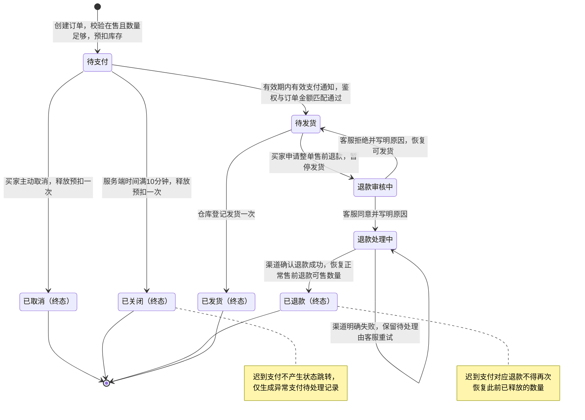

# 题目 01：小型电商的订单交易、发货与售前退款 —— 完整项目需求文档

| 项 | 内容 |
| --- | --- |
| 文档类型 | 项目需求规格说明（需求分析阶段交付物） |
| 版本 | v1.0 |
| 题面来源 | 《Go 项目业务场景题》「题目 01：小型电商的订单交易、发货与售前退款」（第 185～230 行）及「一、所有题目共同适用的要求」（第 11～183 行） |
| 岗位来源 | 北京易博中天｜Golang（短期 1-3 个月）；CSV 职责摘录：「参与商品、订单、支付、促销、退款和履约相关服务的开发与优化」「保障交易和状态同步稳定」 |
| 适用水平与工期 | 约 3 年 Go 后端开发经验；单题 1 天，按 8 小时安排 |
| 文档边界 | 本文档只描述业务需求、规则、状态、边界、假设、验收与页面；**不包含接口设计、数据库表结构设计、代码实现**。上述内容属于后续阶段产物，本文档不产出 |
| 规则优先级 | 题面「题目 01」业务规则 ＞ 题面「共同适用要求」 ＞ 本次技术约束（Go / Gorm / MySQL(InnoDB)（引擎InnoDB，字符集utf8mb4）等） ＞ 第 8 章假设清单。假设不得覆盖或改写题面规则；题面未明确的事项一律进第 8 章，不得当作既定需求 |
| 标注约定 | 文中「【题面】」表示原题明确规定，「【约定】」表示题面未明确、由本实训自行约定并列入第 8 章 |

---

## 1. 项目概述

### 1.1 项目目标

交付一个供**买家、运营、仓库、客服共同使用**的小型交易系统，实现「商品上架 → 买家下单 → 在线支付 → 发货 / 售前退款 / 超时关闭 → 结果核查」的完整业务闭环。

题面指出的核心命题：**单独显示「支付成功」不能说明订单已经正确完成**。一个订单同时影响库存、收款、发货和客服处理，因此系统必须让：

- 买家知道钱和订单去了哪里；
- 仓库知道哪些单可以发；
- 客服知道哪些异常需要处理；
- 运营在活动结束后能核对订单、库存和收退款结果。

### 1.2 现场情境（题面原文情境还原）

一家 Shop 商城销售少量标准商品。本次活动中**某商品只剩 5 件**，多名买家同时下单：其中一人迟迟不付款，一人在付款后、仓库发货前要求退款；支付渠道因网络重试重复发送成功通知，另有一笔成功通知在订单超时关闭后才到达；仓库还可能在客服处理退款时点击发货。若处理不清，可能出现：

- 超卖；
- 重复退款；
- 买家已退款却继续发货；
- 渠道已收款但商城查不到有效订单。

### 1.3 交付范围

| 范围 | 内容 |
| --- | --- |
| 业务闭环 | 正常成交、缺货与弃单、售前退款、迟到支付、操作竞争五组完整工作场景，全部可实际操作并产生持久化结果 |
| 可操作页面 | 4 个极简 HTML 角色页面（商品与订单页、仓库待发货页、客服退款及异常支付页、运营核查页），可合并到少量标签页 |
| 后端 | Go 实现核心业务，Gorm + MySQL(InnoDB)（引擎InnoDB，字符集utf8mb4）持久化；服务重启后业务结果仍可查询 |
| 外部依赖 | 全部第三方为可控 HTTP 模拟服务，主要是模拟支付渠道；固定商品、模拟支付、人工发货登记 |
| 记录 | 审计流水记录所有状态变更；异常记录不可通过直接修改订单状态消失 |
| 质量证据 | 单元测试与覆盖率报告、并发竞争检测、Agent 验收逐项结论与证据 |

### 1.4 单日边界（题面「原型、Skill 与单日边界」）

采用固定商品、模拟支付和人工发货登记；**不做购物车、多商户、真实物流、部分退款或完整财务系统**。必须执行题面第一部分全部共同要求，不能只交支付通知接口。

### 1.5 完成判据（一句话）

五组完整工作场景及关键异常均可从真实业务起点演示到结束核查，每一步结果持久化、可查询、可解释，且测试与线上演示使用相同业务规则。

> 题面第一部分共同要求（开发流程、`AGENTS.md`、自编 Skill、AI 过程记录、Git 流程、自动部署、每日视频等）按原题执行；本文档仅描述业务与质量约束，不在本文档展开流程性要求。

---

## 2. 角色说明

### 2.1 角色职责与操作边界

| 角色 | 题面职责 | 允许的操作 | 不允许的操作 |
| --- | --- | --- | --- |
| 买家 | 浏览在售商品、下单、付款、查询、取消及申请售前退款 | 浏览在售商品；下单；发起付款；查询本人订单；取消本人待支付订单；对本人已付款未发货订单申请整单退款；查看本人退款结果与运单 | 查看或处理他人订单；对已发货订单申请本题售前退款；部分退款；修改订单金额 |
| 运营 | 维护商品上下架，查看可售数量和交易汇总 | 商品上架 / 下架；维护商品售价与可售数量；按订单查询收款、退款、发货、异常处理记录；查看商品可售数量、已收款及已退款汇总；查看审计流水（只读） | 直接改写订单状态以消除异常记录；代替仓库发货、代替客服审核退款 |
| 仓库 | 查询可发货订单，填写承运方和运单号完成发货登记 | 查询合法待发货订单；为合法待发货订单登记一次发货（承运方 + 运单号） | 为未支付、退款审核中、退款处理中、已发货、已关闭、已取消、已退款订单发货；重复登记发货；审核退款 |
| 客服 | 审核售前退款、处理迟到支付并记录原因 | 查看退款申请；同意或拒绝并写明原因；对渠道退款失败记录发起重试；查看异常支付待处理列表并核实迟到支付、记录原因、发起退款；查看支付通知处理结果 | 直接编辑订单状态或库存；代替仓库发货；代替运营做交易汇总；删除异常记录 |
| 模拟支付渠道 | 受理付款、发出支付通知，受理退款并报告退款结果 | 受理付款请求；发出成功支付通知（正常 / 重复 / 迟到 / 验签失败 / 金额不符 / 未知订单）；受理整单退款并报告成功或明确失败 | 直接改写商城订单、库存、退款状态（只能通过通知由商城校验后生效） |

### 2.2 预置账号数据

题面规定：「预置 2 个商品、3 个买家及上述员工账号」。具体账号标识、员工数量、口令承载方式为【约定】，见第 8 章 A-05、A-06。

| 账号标识 | 角色 | 数量 | 数据可见域 | 凭据 |
| --- | --- | --- | --- | --- |
| `buyer01`、`buyer02`、`buyer03` | 买家 | 3 | 仅本人订单、本人退款结果、本人运单 | 预置演示口令，由本地初始化配置设定；本文档、仓库、日志、截图与视频均不记录明文 |
| `ops01` | 运营 | 1 | 全部订单、商品、收退款与发货记录、异常记录、审计流水（只读核查） | 同上 |
| `wh01` | 仓库 | 1 | 合法待发货订单及本人发货登记结果 | 同上 |
| `cs01` | 客服 | 1 | 退款申请、异常支付待处理列表、支付通知处理结果、渠道退款结果 | 同上 |
| `paymock` | 模拟支付渠道（服务，非登录账号） | 1 个 HTTP 模拟服务 | 仅支付 / 退款受理与回调通知 | 渠道标识 + 签名密钥；密钥不进入仓库、日志、截图与视频 |

**身份可信要求**【题面·共同要求第 8 条】：账号可预置，不要求注册登录全套流程；但**角色身份必须可信，不能通过随意修改请求中的用户编号越权操作**。身份由服务端会话 / 凭据解析，不信任请求参数中的用户编号；越权查看或处理他人订单必须有明确拒绝结果。

### 2.3 预置商品数据

| 商品标识 | 名称 | 单价（分） | 初始可售数量 | 初始状态 | 用途 |
| --- | --- | --- | --- | --- | --- |
| `SKU-ACT-01` | 活动商品 A | 10000 | 5 | 在售 | 五组演示场景的主商品；题面「某商品只剩 5 件」 |
| `SKU-REF-02` | 对照商品 B | 10000 | 5 | 下架 | 仅为满足题面「预置 2 个商品」，用于验证「只能购买在售且数量足够的商品」及「订单保存下单时价格，后续调价 / 上下架不改变已有订单金额」；不参与五组场景的库存与金额汇总断言 |

> `SKU-REF-02` 的单价、可售数量与初始状态题面未明确，为【约定】，见 A-07。题面明确「一种商品单价 10000 分、可售数量 5 件」，`SKU-ACT-01` 严格取该值。

### 2.4 角色—页面对应关系

| 角色 | 对应页面 |
| --- | --- |
| 买家 | P-01 商品与订单页 |
| 仓库 | P-02 仓库待发货页 |
| 客服 | P-03 客服退款及异常支付页（含模拟支付渠道控制台子区） |
| 运营 | P-04 运营核查页 |
| 模拟支付渠道 | 无独立角色页面，操作入口为 P-03 内的「模拟支付渠道控制台」子区 |

---

## 3. 业务背景与业务约束

### 3.1 业务背景

运营负责维护商品售价和可售数量，买家通过网页下单并在线支付，仓库人员根据已付款订单发货，客服处理取消、退款和支付异常。业务规模小，但一个订单同时影响库存、收款、发货和客服处理，因此必须以**同一份业务记录**支撑四个角色的协作与最终核查。

### 3.2 业务约束清单

| 编号 | 约束 | 来源 |
| --- | --- | --- |
| C-01 | 金额单位统一为**人民币分**，整数；**不含运费和优惠** | 【题面】 |
| C-02 | **一单只能购买 1 种商品**（单一商品、单一订单行） | 【题面】 |
| C-03 | 每单数量**只能是 1 或 2 件** | 【题面】「数量 1～2 件」 |
| C-04 | 活动商品单价 **10000 分** | 【题面】 |
| C-05 | 活动商品**初始可售 5 件** | 【题面】 |
| C-06 | 应付金额 = 下单时商品单价 × 数量；无运费、无优惠、无税费、无促销 | 【题面】 |
| C-07 | 订单保存下单时的商品与价格；后续上下架和价格调整不改变已有订单金额 | 【题面】规则 1 |
| C-08 | 待付款订单保留 **10 分钟**；超时判断采用**服务端时间** | 【题面】规则 2 |
| C-09 | 预置 2 个商品、3 个买家及员工账号；不实现注册登录全套流程 | 【题面】 |
| C-10 | 固定商品、模拟支付、人工发货登记；第三方为可控 HTTP 模拟服务 | 【题面】 |
| C-11 | 所有业务分支须可实际操作并有持久化结果；不能用静态页面、写死成功结果或文档说明代替；服务重启后结果仍可查询 | 【题面·共同要求】 |
| C-12 | 时间边界可使用可配置教学时钟或缩短时长演示，**必须注明**；测试和线上演示须使用相同业务规则 | 【题面·共同要求第 9 条】 |
| C-13 | 页面须展示操作结果与失败原因 | 【题面·共同要求第 2 条】 |
| C-14 | 金额一律不使用浮点数表示或计算 | 【约定】A-03 |

### 3.3 金额示例（仅用于口径对齐，不构成新增规则）

| 数量 | 应付金额（分） |
| --- | --- |
| 1 件 | 10000 |
| 2 件 | 20000 |

---

## 4. 订单有限状态机

### 4.1 状态定义

题面只描述业务含义、未给定状态名称；下列命名与划分是【约定】，见 A-08，**不改变任何题面规则**。

| 状态 | 含义 | 是否终态 |
| --- | --- | --- |
| 待支付 | 订单已创建，库存已预扣，等待有效期内有效支付通知 | 否 |
| 已取消 | 买家主动取消，预扣已释放一次 | **是** |
| 已关闭 | 服务端时间满 10 分钟超时关闭，预扣已释放一次 | **是** |
| 待发货 | 有效期内收到并校验通过的支付通知，已记款一次 | 否 |
| 退款审核中 | 买家对已付款未发货订单申请整单退款，**发货暂停** | 否 |
| 退款处理中 | 客服同意退款，等待模拟渠道结果；渠道明确失败时仍停留此状态由客服重试 | 否 |
| 已退款 | 模拟渠道确认整单退款成功，正常售前退款已恢复相应可售数量 | **是** |
| 已发货 | 仓库登记承运方与运单号一次 | **是** |

**旁路记录（不属于订单主状态）**：支付通知处理结果记录、异常支付待处理记录、退款流水、库存占用变化记录、发货登记记录、审计流水。特别是**迟到支付不改变订单状态**，只生成异常支付待处理记录。

### 4.2 状态流转图

### 4.3 允许的跳转（逐条）

| 编号 | 当前状态 | 目标状态 | 触发动作 | 前置条件 | 附带结果 |
| --- | --- | --- | --- | --- | --- |
| T-01 | （无） | 待支付 | 买家创建订单 | 商品在售、可售数量 ≥ 购买数量、数量为 1 或 2、一单一种商品 | 保存下单时商品与价格；应付金额 = 单价 × 数量；预扣数量；开始 10 分钟服务端计时 |
| T-02 | 待支付 | 待发货 | 有效支付成功通知 | 通知鉴权通过、订单存在且匹配、金额匹配、渠道交易号未被其他订单占用、**在 10 分钟有效期内到达** | 记款一次；订单状态变更；库存占用不重复变化 |
| T-03 | 待支付 | 已取消 | 买家主动取消 | 订单属于该买家、仍在有效期内 | 释放预扣一次 |
| T-04 | 待支付 | 已关闭 | 服务端时间满 10 分钟 | 超时判断采用服务端时间 | 释放预扣一次 |
| T-05 | 待发货 | 退款审核中 | 买家申请整单售前退款 | 已付款且未发货、订单属于该买家 | 发货暂停；生成退款申请记录 |
| T-06 | 待发货 | 已发货 | 仓库登记发货 | 订单为合法待发货、无待处理退款申请、承运方与运单号已填写 | 发货登记一次；不恢复库存 |
| T-07 | 退款审核中 | 待发货 | 客服拒绝退款 | 必须写明拒绝原因 | 恢复可发货；生成审核记录 |
| T-08 | 退款审核中 | 退款处理中 | 客服同意退款 | 必须写明同意原因 | 向模拟渠道发起整单退款；生成退款流水 |
| T-09 | 退款处理中 | 退款处理中 | 渠道明确退款失败 | 失败结果可查询 | 保留待处理记录；客服可重试；每次重试留痕 |
| T-10 | 退款处理中 | 已退款 | 渠道确认退款成功 | 退款金额等于订单实收金额 | 买家可见退款结果；**正常售前退款**恢复相应可售数量一次 |
| T-11 | 已关闭 | （订单状态不变） | 迟到支付成功通知 | 订单已因超时关闭 | 不恢复订单、不重新占用库存；生成异常支付待处理记录；由客服核实后发起退款；该退款**不恢复**此前已释放数量 |
| T-12 | 已关闭 / 已取消 | （订单状态不变） | 重复关闭请求 | 重复关闭、主动取消与超时关闭同时发生 | 状态不变，**不多释放**占用 |

### 4.4 禁止的跳转（逐条）

| 编号 | 被禁止的跳转 / 操作 | 原因（题面依据） | 系统应给出的结果 |
| --- | --- | --- | --- |
| F-01 | 已关闭 / 已取消 → 待发货 | 迟到支付不能恢复订单或重新占用库存（规则 4） | 拒绝状态变更，订单保持终态，生成异常支付待处理记录 |
| F-02 | 已发货 → 退款审核中 / 退款处理中 / 已退款 | 已发货订单不受理本题售前退款（规则 7） | 明确拒绝并展示原因 |
| F-03 | 已退款 → 已发货 | 退款与发货互斥，只能形成一种合法业务结果（规则 5） | 明确拒绝并展示原因 |
| F-04 | 退款审核中 / 退款处理中 → 已发货 | 申请期间暂停发货（规则 5） | 仓库页显示「暂停发货」及原因，登记发货被拒 |
| F-05 | 待发货及之后 → 已取消 / 已关闭 | 主动取消与超时关闭只作用于待支付（规则 2） | 明确拒绝并展示原因 |
| F-06 | 任意终态 → 任意其他状态 | 终态不可回退；异常记录不能通过直接修改订单状态消失（规则 8） | 明确拒绝；异常记录仍可查询 |
| F-07 | 待支付 → 已发货 | 仓库只能为合法待发货订单发货（规则 7） | 明确拒绝并展示原因 |
| F-08 | 重复关闭 / 重复发货 / 重复记款 / 重复退款（同因自循环） | 重复关闭不多释放、重复通知不重复记款、仓库只登记一次发货（规则 2、3、7） | 第二次及以后返回幂等结果或明确拒绝，不产生第二笔业务结果 |
| F-09 | 未通过鉴权 / 金额不符 / 未知订单的通知 → 待发货 | 有效支付通知须通过鉴权、匹配订单及金额（规则 3） | 订单状态不变，处理结果留存可查询 |
| F-10 | 同一渠道交易号 → 第二个订单 | 同一渠道交易号不得归属于两个订单（规则 3） | 第二次明确拒绝并可查询 |

### 4.5 并发裁决

【题面】要求「退款与发货同时发生时，只能形成一种合法业务结果」「重复支付和退款通知、越权查看或处理他人订单，均须有明确结果」，但未指定谁优先。裁决策略为【约定】A-09：同一订单的所有状态变更串行化处理，首个成功提交者生效，后到者按提交时的当前状态被明确拒绝；不允许出现「既已退款又已发货」「一笔订单两次记款」「一笔订单两次退款」。

---

## 5. 主业务流程

### 5.1 正常下单支付发货流程

对应题面完整工作场景「活动正常成交：运营上架 → 买家购买付款 → 仓库发货 → 买家查询运单 → 运营核查收款与库存」。

`运营上架 → 买家下单（预扣）→ 模拟渠道受理付款 → 支付成功通知校验 → 待发货 → 仓库登记发货 → 已发货 → 买家查运单 / 运营核查`

| 步骤 | 角色 | 动作 | 系统校验与处理 | 持久化结果 |
| --- | --- | --- | --- | --- |
| 1 | 运营 | 将活动商品置为在售 | 商品在售、可售数量 5 件 | 商品状态与数量 |
| 2 | 买家 | 浏览在售商品，选择 1 种商品、数量 1 或 2，提交下单 | 在售 + 可售数量足够 + 数量合法；保存下单时商品与价格；金额 = 单价 × 数量 | 订单（待支付）、库存预扣记录、审计流水 |
| 3 | 买家 | 发起付款 | 模拟支付渠道受理付款 | 付款受理记录 |
| 4 | 模拟支付渠道 | 发出成功支付通知 | 鉴权 → 匹配订单 → 匹配金额 → 校验渠道交易号唯一 → 校验在 10 分钟有效期内 | 收款记录一条、支付通知处理结果、订单转待发货、审计流水 |
| 5 | 仓库 | 查询可发货订单，填写承运方与运单号，登记发货 | 订单为合法待发货且无待处理退款申请；仅登记一次 | 发货登记、订单转已发货、审计流水 |
| 6 | 买家 | 查询本人订单 | 仅本人可见 | 展示状态、金额、承运方、运单号、发货时间 |
| 7 | 运营 | 核查收款与库存 | 按订单查询收款、退款、发货、异常记录；查看可售数量、已收款及已退款汇总 | 汇总与逐笔记录一致；异常记录为空 |

**分支**：本流程任一步失败，页面必须展示失败原因；结果不得写死为成功。

### 5.2 售前退款审核流程

对应题面完整工作场景「售前退款：买家付款后申请 → 仓库尝试发货受限 → 客服批准 → 首次退款失败、再次成功 → 订单与数量恢复一致」。

`待发货 → 买家申请整单退款（发货暂停）→ 仓库发货被拒 → 客服同意 → 渠道退款失败（保留待处理）→ 客服重试 → 渠道退款成功 → 已退款 + 恢复可售数量`

| 步骤 | 角色 | 动作 | 系统处理 | 持久化结果 |
| --- | --- | --- | --- | --- |
| 1 | 买家 | 对本人已付款未发货订单申请整单退款 | 校验状态；整单全额，不做部分退款 | 订单转退款审核中、退款申请记录、审计流水 |
| 2 | 仓库 | 尝试登记发货 | 申请期间暂停发货 | 明确拒绝并展示「暂停发货」原因，订单状态不变 |
| 3 | 客服 | 同意或拒绝并写明原因 | 拒绝 → 回待发货，允许继续发货；同意 → 退款处理中，向渠道发起整单退款 | 审核记录（审核人、原因、时间）、退款流水、审计流水 |
| 4 | 模拟支付渠道 | 报告**明确失败** | 保留待处理记录，不关闭、不改订单状态 | 失败结果、待处理记录、审计流水 |
| 5 | 客服 | 重试退款 | 重新发起，仍遵守「只形成一种合法结果」 | 每次重试结果留痕 |
| 6 | 模拟支付渠道 | 确认退款成功 | 订单转已退款；**正常售前退款**恢复该订单数量的可售数量一次 | 退款结果、库存恢复记录、审计流水 |
| 7 | 买家 / 运营 | 查询退款结果与库存 | 买家可见退款结果；运营核对订单、数量、收退款 | 订单与数量恢复一致，退款金额 = 实收金额 |

**关键边界**：已发货订单不受理本题售前退款；退款与发货并发只能形成一种合法业务结果；重复退款通知不得重复退款；迟到支付对应的退款不得再次恢复此前已释放数量。

### 5.3 待支付订单超时关闭流程

对应题面「待付款订单保留 10 分钟」「超时关闭后收到成功通知」及完整工作场景「迟到支付」。

`待支付 → 买家主动取消 / 服务端满 10 分钟 → 已取消 / 已关闭（释放预扣一次）→ 迟到成功通知到达 → 异常支付待处理列表 → 客服核实并记原因 → 发起退款 → 运营确认无重复释放、无重复退款`

| 步骤 | 角色 | 动作 | 系统处理 | 持久化结果 |
| --- | --- | --- | --- | --- |
| 1 | 系统 | 订单创建后开始计时 | 超时判断采用**服务端时间** | 待支付订单与计时起点 |
| 2 | 买家 / 系统 | 主动取消 或 满 10 分钟 | 释放占用一次；重复关闭不多释放；主动取消与超时关闭同时发生只生效一次 | 状态转已取消 / 已关闭、库存释放记录、审计流水 |
| 3 | 模拟支付渠道 | 订单关闭后到达成功支付通知 | **不恢复订单、不重新占用库存**；记入异常支付待处理列表 | 异常支付记录、支付通知处理结果、审计流水 |
| 4 | 客服 | 从异常列表发现并核实，记录原因，发起退款 | 走模拟渠道退款；该退款**不得再次恢复此前已释放数量** | 处理原因、核实人、关联退款流水、审计流水 |
| 5 | 运营 | 核查 | 订单仍为终态；异常记录可查；无重复释放、无重复退款 | 汇总与逐笔记录一致 |

> 演示时可用可配置教学时钟缩短 10 分钟时长，但**必须注明**，且测试与线上演示使用相同业务规则（C-12、A-01）。

---

## 6. 全部业务规则（逐条）

### 6.1 商品与下单

- **R-01**【题面·规则 1】买家只能购买**在售且数量足够**的商品；不满足时明确拒绝并展示原因，不产生订单、不预扣库存。
- **R-02**【题面·规则 1】订单保存**下单时的商品与价格**；后续上下架和价格调整**不改变已有订单金额**。
- **R-03**【题面·规则 1】创建订单后的可售数量须能反映**已占用数量**。
- **R-04**【题面·参与角色】一单仅购买一种商品，数量 1～2 件；应付金额 = 下单时单价 × 数量（分），不含运费和优惠。
- **R-05**【题面·场景「缺货与弃单」】20 个并发下单请求争抢有限数量时不得超卖：任一时刻已占用数量与可售数量之和等于初始可售数量，超出部分明确拒绝并记录原因。

### 6.2 库存预扣逻辑（重点）

- **R-06**【题面·规则 1、2】下单成功即**预扣**该订单数量（1 或 2 件），可售数量相应减少；预扣与订单创建必须同时成功或同时失败，不允许「有订单无占用」或「有占用无订单」。
- **R-07**【题面·规则 2】买家主动取消或超时关闭后**释放**占用；释放只发生一次。
- **R-08**【题面·规则 2】**重复关闭不多释放**；主动取消与超时关闭并发时只产生一次释放。
- **R-09**【题面·规则 6】**正常售前退款**经渠道确认成功后**恢复相应可售数量**（等于该订单购买数量），且只恢复一次。
- **R-10**【题面·规则 6】**迟到支付对应的退款不得再次恢复此前已释放的数量**；该订单关闭时已释放，退款不得二次增加可售数量。
- **R-11**【题面·规则 7】已发货订单不恢复库存。
- **R-12**【题面·规则 3】支付成功通知**不重复预扣、不重复释放**；重复通知不改变库存占用。
- **R-13**【约定 A-10】库存变化逐笔留痕，原因分为预扣、关闭释放、取消释放、正常售前退款恢复；同一订单同一原因至多产生一笔变化，便于运营核算「初始 5 − 占用 + 释放 + 恢复」与当前可售数量一致。

### 6.3 支付回调幂等（重点）

- **R-14**【题面·规则 3】有效支付通知须通过**鉴权**、**匹配订单**及**匹配金额**；三者任一不通过，不得使订单进入待发货。
- **R-15**【题面·规则 3】**重复通知不能重复记款**；同一订单只形成一条有效收款记录，重复通知返回幂等结果，不改变订单状态与库存。
- **R-16**【题面·规则 3】**同一渠道交易号不得归属于两个订单**；违反时第二个关联明确拒绝并可查询。
- **R-17**【题面·规则 3】**金额不符、未知订单、验签失败须能查询处理结果**：不得静默丢弃，处理结果须持久化并可在客服页查询。
- **R-18**【题面·规则 4】**只有服务端在订单有效期内收到并校验通过的付款通知**才可使订单进入待发货。
- **R-19**【题面·场景「操作竞争」】重复支付通知、重复退款通知均须有明确结果，不得重复记款、不得重复退款、不得重复恢复库存。

### 6.4 迟到支付（重点）

- **R-20**【题面·规则 4】超时关闭后收到成功支付通知，**不能恢复订单或重新占用库存**。
- **R-21**【题面·规则 4】该通知应进入**异常支付待处理列表**，由**客服核实后发起退款**并记录原因。
- **R-22**【题面·规则 6】迟到支付对应的退款**不得再次恢复此前已释放的数量**（与 R-10 同源，此处为独立核查点）。
- **R-23**【题面·规则 8】异常记录**不能通过直接修改订单状态消失**；任何角色不得通过改状态清除异常支付记录。
- **R-24**【题面·场景「迟到支付」】运营须能确认「无重复释放和重复退款」：订单保持终态、异常记录可查、退款至多一次、库存变化至多一次。

### 6.5 退款与发货互斥（重点）

- **R-25**【题面·规则 5】买家对**已付款但未发货**订单可申请**整单退款**（全额，不做部分退款）。
- **R-26**【题面·规则 5】**申请期间暂停发货**：退款审核中 / 退款处理中状态下仓库登记发货必须被拒并展示原因。
- **R-27**【题面·规则 5】客服可**同意或拒绝并写明原因**；拒绝后订单回到待发货，**允许继续发货**。
- **R-28**【题面·规则 5】**退款与发货同时发生时，只能形成一种合法业务结果**：不允许「已退款且已发货」「既记退款又记发货」。
- **R-29**【题面·规则 6】退款经模拟渠道**确认成功**后，买家能看到退款结果；渠道**明确失败**时保留待处理记录，由客服**重试**，失败期间订单不回到可发货状态。
- **R-30**【题面·规则 6】退款状态独立可查询；退款金额等于订单实收金额；重复退款通知不重复退款。
- **R-31**【题面·规则 7】仓库**只能为合法待发货订单登记一次发货**（承运方 + 运单号）；重复登记被拒。
- **R-32**【题面·规则 7】**已发货订单不受理本题售前退款**；本题不实现签收、退货及售后物流。

### 6.6 权限隔离（重点）

- **R-33**【题面·共同要求第 8 条】**角色身份必须可信**，不能通过随意修改请求中的用户编号越权操作；身份由服务端会话 / 凭据解析。
- **R-34**【题面·场景「操作竞争」】**越权查看或处理他人订单须有明确结果**：买家只能查看、取消、申请退款本人订单；越权请求明确拒绝、不返回他人数据、留痕。
- **R-35**【题面·参与角色】仓库仅查询可发货订单并登记发货；客服仅审核退款、处理迟到支付并记录原因；运营维护商品上下架与售价 / 可售数量、查看汇总与记录。
- **R-36**【题面·规则 8】运营**只有查询权与商品维护权**，不得直接改写订单状态；异常记录不能通过直接修改订单状态消失。
- **R-37**【题面·规则 8】每个角色对不属于本职的操作（如仓库审核退款、客服登记发货、买家处理异常支付）均须明确拒绝并展示原因。

### 6.7 记录与核查

- **R-38**【题面·规则 8】运营可**按订单查询收款、退款、发货和异常处理记录**，并查看**商品可售数量、已收款及已退款汇总**。
- **R-39**【题面·业务背景】运营在活动结束后能核对订单、库存和收退款结果；不能把所有已付款都计作已完成发货，也不能把已退款金额计作已收款。
- **R-40**【本次技术约束】所有状态变更必须有审计流水记录，只追加、不可修改、不可删除（详见 11.4）。

### 6.8 通用结果要求

- **R-41**【题面·共同要求第 9 条】各题要求的业务分支均须**可实际操作并有持久化结果**，不能用静态页面、写死成功结果或文档说明代替。
- **R-42**【题面·共同要求第 2 条】页面须展示**操作结果与失败原因**。
- **R-43**【题面·共同要求第 3 条】服务重启后业务结果仍可查询。
- **R-44**【题面·共同要求第 9 条】时间边界可使用可配置教学时钟或缩短时长演示，**必须注明**；测试和线上演示须使用相同业务规则。
- **R-45**【题面·共同要求第 5 条】第三方模拟服务必须能触发题面要求的**成功、失败、超时及重复通知**场景；不得将模拟服务当作真实第三方接入成果。

---

## 7. 异常 & 边界场景

### 7.1 五组必须演示的完整工作场景

题面「必须演示的完整工作场景」共五组。下表按本次要求的五组命名组织，并给出与题面场景的对应关系，供验收 Agent 逐组核对。

#### S-01 并发抢单

| 项 | 内容 |
| --- | --- |
| 对应题面场景 | 缺货与弃单（并发争抢部分）＋ 操作竞争 |
| 前置 | 活动商品在售、可售 5 件、单价 10000 分；3 个预置买家账号 |
| 操作序列 | 20 个并发下单请求同时争抢有限数量，每单数量取 1 或 2 件 |
| 预期结果 | ① 预扣成功订单的数量合计 ≤ 5，**绝不超卖**；② 每个成功订单都有对应库存预扣记录；③ 其余请求明确返回「可售数量不足」等原因，不产生订单、不产生孤立占用；④ 已占用 + 可售 = 5；⑤ 并发执行后无数据竞争 |
| 持久化核查点 | 订单记录、库存变化流水、被拒请求处理结果、审计流水 |
| 关联规则 | R-01、R-03、R-05、R-06 |
| 关联验收项 | AC-05 |

#### S-02 重复支付通知

| 项 | 内容 |
| --- | --- |
| 对应题面场景 | 操作竞争（重复支付和退款通知）＋ 规则 3 |
| 前置 | 存在待支付订单，金额已按 10000 × 数量确定 |
| 操作序列 | 模拟渠道对同一订单连续发出 3 次内容相同的支付成功通知；再分别发出金额不符、未知订单、验签失败通知各一次；再尝试把同一渠道交易号关联到第二个订单；退款成功后重复发送退款通知 |
| 预期结果 | ① 仅记款一条，订单仅一次进入待发货；② 库存占用不重复变化；③ 金额不符 / 未知订单 / 验签失败各自订单状态不变且**处理结果可查询**；④ 同一渠道交易号关联第二个订单被拒且可查询；⑤ 重复退款通知不重复退款、不重复恢复库存 |
| 持久化核查点 | 收款记录条数、支付通知处理结果、异常查询列表、退款流水条数 |
| 关联规则 | R-14 ～ R-19、R-30 |
| 关联验收项 | AC-06、AC-07、AC-08、AC-13 |

#### S-03 迟到支付

| 项 | 内容 |
| --- | --- |
| 对应题面场景 | 迟到支付：订单先关闭 → 支付成功通知到达 → 客服从异常列表发现 → 发起退款 → 运营确认无重复释放和重复退款 |
| 前置 | 待支付订单已因满 10 分钟（或演示缩短时长并注明）关闭，预扣已释放一次 |
| 操作序列 | 关闭后到达成功支付通知 → 客服从异常支付待处理列表核实、记录原因、发起退款 → 渠道确认退款成功 → 运营核查 |
| 预期结果 | ① 订单**保持已关闭终态**，不恢复、不重新占用库存；② 异常支付待处理列表新增一条并可查询；③ 客服处理原因与核实人留痕；④ 退款至多一次；⑤ 该退款**不得再次恢复此前已释放数量**，可售数量不二次增加；⑥ 运营确认无重复释放、无重复退款；⑦ 异常记录不因任何状态改写消失 |
| 持久化核查点 | 订单终态、异常支付记录、客服处理记录、退款流水、库存变化流水、审计流水 |
| 关联规则 | R-20 ～ R-24、R-10 |
| 关联验收项 | AC-10、AC-17、AC-20 |

#### S-04 退款发货并发竞争

| 项 | 内容 |
| --- | --- |
| 对应题面场景 | 操作竞争（退款申请与发货并发）＋ 售前退款完整链路 |
| 前置 | 已付款未发货订单（待发货） |
| 操作序列 | ① 买家申请整单退款与仓库登记发货**并发**发起；② 买家申请后仓库再次尝试发货；③ 客服同意 → 渠道首次退款失败 → 重试成功；④ 另一订单走客服拒绝 → 继续发货；⑤ 已发货订单再申请退款；⑥ 重复登记发货 |
| 预期结果 | ① 并发只形成**一种合法业务结果**（要么退款链路继续，要么发货成立），绝不出现「已退款且已发货」；② 后到者按当前状态被明确拒绝并展示原因；③ 申请期间仓库发货被拒并显示「暂停发货」；④ 首次退款失败保留待处理，重试成功订单转已退款并恢复相应可售数量；⑤ 客服拒绝后允许继续发货；⑥ 已发货订单申请退款被拒；⑦ 重复发货登记被拒，运单号不变；⑧ 全程无数据竞争 |
| 持久化核查点 | 订单状态、退款流水、发货登记条数、库存恢复记录、审核记录、审计流水 |
| 关联规则 | R-25 ～ R-32、R-28 |
| 关联验收项 | AC-11、AC-12、AC-13、AC-14 |

#### S-05 缺货弃单

| 项 | 内容 |
| --- | --- |
| 对应题面场景 | 缺货与弃单：20 个并发下单请求争抢有限数量 → 部分订单未付款关闭 → 其他买家购买释放的商品 |
| 前置 | S-01 之后，存在若干待支付订单占用库存，可售数量已不足以接纳新单 |
| 操作序列 | ① 部分待支付订单不付款，分别走买家主动取消与满 10 分钟超时关闭；② 对同一订单重复发起关闭；③ 释放后由其他买家再次下单购买；④ 再次尝试超出可售数量的下单 |
| 预期结果 | ① 取消 / 关闭各释放一次；② **重复关闭不多释放**，主动取消与超时关闭同时发生只释放一次；③ 释放的商品可被其他买家成功购买，可售数量与占用守恒；④ 库存不足的下单明确拒绝且不产生订单；⑤ 关闭后到达的支付通知按 S-03 处理 |
| 持久化核查点 | 库存变化流水（每单每因至多一笔）、订单终态、新订单、被拒请求结果 |
| 关联规则 | R-07、R-08、R-13、R-01 |
| 关联验收项 | AC-09、AC-15 |

### 7.2 其他必须覆盖的边界与异常

| 编号 | 边界 / 异常 | 预期结果 |
| --- | --- | --- |
| E-01 | 数量为 0、3 件或负数 | 明确拒绝，不创建订单、不预扣 |
| E-02 | 购买已下架商品 | 明确拒绝并展示原因 |
| E-03 | 可售不足时下单 2 件 | 明确拒绝，库存不变 |
| E-04 | 一单提交两种商品 | 明确拒绝 |
| E-05 | 商品下架或调价后查询已有订单 | 订单商品与金额保持下单时快照不变 |
| E-06 | 未支付订单尝试登记发货 | 明确拒绝 |
| E-07 | 支付通知金额与订单不符 | 订单不变，处理结果可查询 |
| E-08 | 支付通知指向未知订单 | 订单不变，处理结果可查询 |
| E-09 | 验签失败的支付通知 | 订单不变，处理结果可查询 |
| E-10 | 同一渠道交易号指向两个订单 | 第二次被拒并可查询 |
| E-11 | 重复退款通知 / 重复登记发货 / 重复关闭 | 幂等结果或明确拒绝，不产生第二笔业务结果 |
| E-12 | 渠道明确退款失败 | 保留待处理记录，客服可重试，订单不回到可发货 |
| E-13 | 尝试直接修改订单状态消除异常记录 | 被拒，异常记录仍可查询 |
| E-14 | 越权查看、取消、申请退款、审核、发货他人订单 | 明确拒绝、不泄露他人数据、留痕 |
| E-15 | 服务重启后查询上述全部结果 | 结果与重启前一致、可查询 |
| E-16 | 模拟渠道触发超时 / 迟到 / 重复通知 | 均可由模拟服务复现，商城按题面规则处理 |

---

## 8. 假设清单【重要，实训作业必须】

**原则**：题面未明确的事项必须记录假设，**不能将猜测当成既定需求**；假设不得覆盖题面规则。下表「题面状态」列区分「已明确」（仅约定演示 / 落地方式）与「未明确」（自行约定）。

### 8.1 题面已明确、本条仅约定落地方式

| 编号 | 约定项 | 题面状态 | 本实训约定内容 | 核查方式 |
| --- | --- | --- | --- | --- |
| A-01 | **超时时间** | 已明确：待付款订单保留 10 分钟、超时判断用服务端时间 | 生产与测试规则固定为 10 分钟；演示允许通过**可配置教学时钟缩短时长**，但**必须注明缩短值**，且测试与线上演示使用相同业务规则；缩短只作用于演示配置，不改变规则本身 | 演示记录中的时长说明；超时用例结果 |
| A-02 | 时间基准 | 已明确：服务端时间 | 统一使用服务端时间，业务展示时区为北京时间；所有审计与状态变更时间以服务端时间为准 | 审计流水时间一致性 |
| A-14 | 迟到支付退款不恢复库存 | 已明确：不得再次恢复此前已释放数量 | 约定该结论记入异常支付记录、退款流水与审计流水，运营页可单独核查「本单未产生库存恢复」 | 库存变化流水 |
| A-20 | 并发抢单规模 | 已明确：20 个并发下单请求、活动商品 5 件 | 约定每单数量在 1 或 2 件中取值，不预设哪几个买家成功，只以库存守恒校验结果 | 并发测试原始输出 |

### 8.2 题面未明确、由本实训自行约定

| 编号 | 约定项 | 本实训约定内容 | 影响范围 / 核查方式 |
| --- | --- | --- | --- |
| A-03 | **不使用浮点数** | 所有金额一律以整数「分」存储、计算、比较与展示口径；不使用浮点数、不做浮点中间运算；页面如需展示「元」仅做格式化显示，不改变存储与计算口径 | 金额计算、汇总、退款金额比对 |
| A-04 | **审计日志只追加不可修改** | 建立审计流水，记录所有状态变更；**只追加（append-only）**，不可修改、不可删除；不提供任何编辑 / 删除入口；异常记录不能通过直接修改订单状态消失 | 审计流水完整性、AC-20 |
| A-05 | 角色身份机制 | 预置账号 + 服务端会话 / 凭据；身份由服务端解析，**不信任请求参数中的用户编号**；不实现注册登录全套流程、真实短信、复杂后台 | 越权用例、AC-16 |
| A-06 | 预置账号明细 | 3 个买家 `buyer01`～`buyer03`；员工账号各 1 个（`ops01` / `wh01` / `cs01`）；统一演示口令由本地初始化配置设定，**本文档、仓库、日志、截图、视频均不记录明文** | 初始化数据核对 |
| A-07 | 第二个商品 | 题面要求预置 2 个商品但只明确一种商品的单价与数量；约定 `SKU-REF-02` 同为 10000 分 / 可售 5 件 / **初始下架**，仅用于上下架与库存校验演示，不参与五组场景的库存与金额汇总断言 | 预置数据核对 |
| A-08 | 订单状态命名与终态划分 | 第 4 章状态名、终态集合为自行约定；题面只描述业务含义。命名不改变任何题面规则，终态为已取消、已关闭、已退款、已发货 | 状态机与题面规则逐条比对 |
| A-09 | **并发裁决策略** | 题面只要求「只能形成一种合法业务结果」，未指定优先方；约定同一订单的状态变更串行化处理（单订单粒度排他），**首个成功提交者生效**，后到者按当前状态被明确拒绝；不允许双重业务结果 | 并发与 race 用例 |
| A-10 | 库存口径 | 可售数量 = 初始可售数量 − 未释放占用 + 已登记释放 / 恢复；库存变化按「预扣 / 取消释放 / 关闭释放 / 正常售前退款恢复」逐笔留痕，同一订单同一原因至多一笔；不引入货位、批次、在途库存概念 | 运营汇总与流水核算 |
| A-11 | 支付通知鉴权方式 | 模拟渠道与商城约定共享签名密钥 + 签名校验；验签失败须留存可查询的处理结果；密钥不进入仓库、日志、截图与视频 | 验签失败用例 |
| A-12 | 渠道交易号唯一性口径 | 渠道交易号全局唯一，一个交易号至多归属一个订单；重复通知以「渠道交易号 + 通知内容」判定幂等；同编号但内容不同按冲突拒绝并留痕 | 幂等用例 |
| A-13 | 退款口径 | 仅整单全额退款，退款金额等于订单实收金额；退款结果独立可查询；渠道明确失败保留待处理由客服重试；题面未规定重试上限，约定**不设固定上限但每次重试必须留痕** | 退款流水与待处理列表 |
| A-15 | 发货登记内容 | 承运方与运单号为人工填写的文本，不做真实物流校验、不做运单格式校验；同一订单只登记一次；不实现签收与物流轨迹 | 发货登记用例 |
| A-16 | 通知方式 | 采用站内消息 / 页面展示与页面刷新查询，不做短信、邮件、WebSocket 推送 | 页面核查 |
| A-17 | 页面形态 | 极简 HTML 页面，4 个角色页可合并为少量标签页；不要求复杂视觉设计，不强制前端框架 | 原型核查 |
| A-18 | 数据持久化与技术栈 | 核心业务数据存数据库，服务重启后可查；本次约定使用 **MySQL(InnoDB) + Gorm（引擎InnoDB，字符集utf8mb4）**，不强制微服务拆分；缓存、消息队列按实际需要选用，不以组件数量评分 | 重启核查 |
| A-19 | **模拟第三方** | 模拟支付渠道为本地可控 **HTTP 模拟服务**，非真实第三方；必须支持正常回调、重复回调、迟到回调、退款失败，并支持退款成功、验签失败、金额不符、未知订单以覆盖校验规则；模拟服务的通知记录持久化可核查；**不得当作真实第三方接入成果** | 模拟服务触发与结果核查 |
| A-21 | 越权判定结果 | 统一为「明确拒绝 + 展示原因 + 留痕」，不返回他人数据、不静默成功、不部分执行 | 越权用例 |
| A-22 | 异常记录留存 | 异常支付、验签失败、金额不符、未知订单、退款失败等记录独立留存，不随订单状态改写而删除或变更 | 异常列表核查 |
| A-23 | 演示数据初始化 | 由初始化数据灌入固定商品、账号与初始库存；每次演示从同一初始状态开始；不提供业务运行期的「一键清空业务记录」功能 | 初始化核对 |
| A-24 | 页面失败原因文案 | 所有失败 / 拒绝均返回可展示的中文原因（如可售数量不足、状态不允许、无权限、重复操作、验签失败），不使用空结果或写死成功 | 页面核查 |
| A-25 | 运营汇总口径 | 汇总仅包含题面要求的「商品可售数量、已收款、已退款」及按订单的收款 / 退款 / 发货 / 异常记录；不新增净额、毛利、对账等财务指标 | 汇总核查 |

---

## 9. 验收条件（供验收 Agent 逐项校验）

### 9.1 使用说明

- 验收 Agent 须使用**相互独立的会话 / 任务上下文**，**读取原始题面与对应版本代码**，不能仅根据开发 Agent 的完成声明判断通过。
- 每项须给出「通过 / 不通过」结论及**证据位置**（页面结果、持久化查询结果、审计流水、模拟渠道记录、测试原始输出、覆盖率报告、race 检测输出）。
- 验收须检查业务正确性、权限、数据一致性、错误处理、可维护性和敏感信息处理。
- 验收后修改业务代码，必须重新运行受影响检查；结论与提交版本须一一对应。

### 9.2 主流程与预置数据

| 编号 | 验收项 | 验证步骤 | 通过标准 | 关联 |
| --- | --- | --- | --- | --- |
| AC-01 | 预置数据 | 初始化后查询商品与账号 | 2 个商品；活动商品单价 10000 分、可售 5 件、在售；3 个买家 + 运营 / 仓库 / 客服各 1 账号可登录；模拟渠道服务可用 | 第 2 章、A-06、A-07 |
| AC-02 | 正常成交全链路 | 运营上架 → `buyer01` 下单 2 件 → 支付成功 → 仓库填承运方与运单号发货 → 买家查运单 → 运营核查 | 应付金额 20000 分；订单已发货；买家可见运单；运营查到已收款 20000 分、已退款 0 分、可售 3 件、发货记录 1 条、异常记录 0 条 | 5.1、R-01～R-04 |
| AC-03 | 下单快照 | 成交后运营调价 / 下架商品，再查该订单 | 订单商品、单价、金额保持下单时值不变 | R-02 |
| AC-04 | 非法下单 | 分别提交数量 0 / 3、已下架商品、可售 1 件时买 2 件、一单两种商品 | 全部明确拒绝并展示原因；不产生订单、库存不变 | R-01、R-04、E-01～E-04 |

### 9.3 业务规则与数据一致性

| 编号 | 验收项 | 验证步骤 | 通过标准 | 关联 |
| --- | --- | --- | --- | --- |
| AC-05 | 并发抢单 | 20 个并发下单请求争抢 5 件，重复执行多次并开启竞争检测 | 成功预扣数量合计 ≤ 5；无超卖；已占用 + 可售 = 5；被拒请求有原因与记录；无数据竞争报告 | S-01、R-05、R-06 |
| AC-06 | 支付回调幂等 | 同一订单连发 3 次相同成功通知 | 收款记录 1 条；订单仅一次进入待发货；库存占用不变；重复通知有明确结果 | S-02、R-15 |
| AC-07 | 支付通知校验 | 各触发一次金额不符、未知订单、验签失败 | 订单状态不变；三类处理结果均可在客服页查询；无静默丢弃 | R-14、R-17 |
| AC-08 | 渠道交易号唯一 | 用同一交易号分别通知两个订单 | 第二次被拒并可查询；一个交易号至多归属一个订单 | R-16 |
| AC-09 | 超时关闭与重复关闭 | 待支付订单满 10 分钟（或注明缩短时长）；对同单重复发起关闭；主动取消与超时关闭并发 | 状态转已关闭 / 已取消；库存仅释放一次；重复关闭不多释放；并发只生效一次 | 5.3、R-07、R-08 |
| AC-10 | 迟到支付 | 已关闭订单收到成功通知 → 客服核实记原因 → 发起退款成功 → 运营核查 | 订单保持已关闭终态；库存未重新占用；异常支付记录可查；退款 1 次；该退款未再次恢复已释放数量；无重复释放与重复退款 | S-03、R-20～R-24 |
| AC-11 | 售前退款全链路 | 买家申请 → 仓库发货被拒 → 客服同意记原因 → 渠道首次失败 → 重试成功 | 申请期间显示「暂停发货」；失败保留待处理；成功订单转已退款；恢复数量等于订单数量且仅一次；买家可见退款结果；退款金额 = 实收金额 | 5.2、S-04、R-25～R-30 |
| AC-12 | 退款拒绝分支 | 客服拒绝并写明原因 → 仓库继续发货 → 已发货后再申请退款 | 拒绝后回待发货并可发货；已发货订单申请售前退款被拒并展示原因；审核记录含审核人与原因 | R-27、R-32 |
| AC-13 | 退款与发货并发竞争 | 同一订单并发「申请退款」与「登记发货」；重复退款通知 | 仅形成一种合法业务结果；无「已退款且已发货」；后到者被明确拒绝；重复退款通知不重复退款、不重复恢复库存；无数据竞争报告 | S-04、R-28、R-30 |
| AC-14 | 发货唯一 | 对同一订单重复登记发货 | 第二次被拒；承运方与运单号不变；发货登记记录 1 条 | R-31 |
| AC-15 | 缺货弃单与库存循环 | 并发后部分订单不付款关闭 → 重复关闭 → 其他买家购买释放商品 → 再尝试超量下单 | 释放数量可被再次购买；库存守恒；重复关闭不多释放；超量下单明确拒绝 | S-05、R-13 |
| AC-16 | 权限隔离 | `buyer02` 查询 / 取消 / 申请退款 `buyer01` 订单；仓库审核退款；客服登记发货；改请求中的用户编号 | 全部明确拒绝、不返回他人数据、留痕；身份由服务端解析，改编号无效 | R-33～R-37、A-05、A-21 |
| AC-17 | 异常记录不可消失 | 尝试直接修改订单状态以消除异常支付 / 退款失败记录 | 被拒；异常记录仍可查询；审计流水完整 | R-23、A-04、A-22 |
| AC-18 | 运营核查 | 运营按订单查询四类记录并查看汇总 | 可售数量、已收款、已退款与逐笔记录一致；异常待处理可识别；汇总无额外财务指标 | R-38、R-39、A-25 |
| AC-19 | 持久化 | 完成上述场景后重启服务再查询 | 所有订单、收款、退款、发货、异常、库存与审计结果与重启前一致 | R-43 |

### 9.4 质量与工程约束

| 编号 | 验收项 | 验证步骤 | 通过标准 | 关联 |
| --- | --- | --- | --- | --- |
| AC-20 | 审计流水 | 抽查每个状态变更节点 | 每次状态变更均有对应流水；只追加、无修改 / 删除入口；可追溯角色、时间、原因与变更前后结果 | 11.4、A-04 |
| AC-21 | 原型页面 | 逐个操作 4 个角色页 | 4 页可操作；每个失败操作展示失败原因；结果来自持久化数据；无静态页或写死成功 | 第 10 章、R-41、R-42 |
| AC-22 | 模拟第三方 | 通过模拟渠道控制台依次触发正常回调、重复回调、迟到回调、退款失败（及退款成功、验签失败、金额不符、未知订单） | 全部可复现且商城按题面规则处理；模拟服务未被宣称为真实第三方 | 11.3、A-19、R-45 |
| AC-23 | 单元测试覆盖率 | 运行单元测试并导出覆盖率原始文件与报告 | 自编 Go 生产代码整体语句覆盖率 ≥ 85%，各核心业务包分别 ≥ 85%；覆盖正常流程、边界、非法状态、重复操作、权限校验及指定异常路径；集成测试不得代替单元测试；不得通过删除失败测试、弱化断言、跳过关键路径、任意排除自编生产代码达标 | 11.2 |
| AC-24 | 并发竞争检测 | 对所有含共享并发访问的逻辑执行竞态检测 | 提供可重复执行的并发验证；竞态检测无数据竞争报告；`gofmt` 与 `go vet` 通过；质量检查失败不得继续发布 | 11.2 |
| AC-25 | 规则一致性 | 对比测试环境、演示环境与演示记录 | 测试与线上演示使用相同业务规则；如缩短时长，演示记录已注明缩短值；无「演示专用」的特例成功结果 | C-12、A-01、R-44 |

---

## 10. 原型页面说明

### 10.1 总体要求

- **极简 HTML 页面**，4 个角色页面，可合并到少量标签页；不要求复杂视觉设计。
- 每个页面都必须能**发起业务、查询结果、展示失败原因**；结果来自数据库持久化，不得用静态页面、写死成功结果或文档说明代替。
- 角色身份由服务端会话决定；页面不得通过修改请求中的用户编号切换身份。
- 模拟支付渠道**不设独立角色页面**，其触发入口为 P-03 内的「模拟支付渠道控制台」子区。

### 10.2 P-01 商品与订单页（买家）

| 项 | 内容 |
| --- | --- |
| 操作 | 切换当前预置买家身份（演示用）；浏览在售商品；选择 1 种商品、输入数量 1 或 2、提交下单；对本人待支付订单发起付款、主动取消、查询；对本人待发货订单申请整单售前退款；查询本人订单详情、退款结果、运单 |
| 展示字段 | 商品：标识、名称、单价（分）、可售数量、在售状态 订单：订单编号、商品名称、下单时单价（分）、数量、应付金额（分）、订单状态、下单时间、待支付剩余时间 支付：支付结果、渠道交易号、收款时间 退款：退款状态、退款金额（分）、退款结果、审核原因、渠道失败原因 发货：承运方、运单号、发货时间 失败原因：可售数量不足、商品未上架、数量非法、状态不允许、重复操作、无权限等 |
| 展示约束 | 仅展示本人订单；他人订单不可见、不可操作；越权尝试展示明确拒绝原因 |

### 10.3 P-02 仓库待发货页（仓库）

| 项 | 内容 |
| --- | --- |
| 操作 | 查询可发货订单；填写承运方与运单号并登记发货（一次）；查询登记结果与拒绝原因 |
| 展示字段 | 订单编号、商品名称、数量、金额（分）、订单状态、付款时间、是否可发货、暂停发货原因、承运方、运单号、发货时间、操作拒绝原因 |
| 展示约束 | 仅合法待发货订单可作为发货对象；退款审核中 / 退款处理中显示「暂停发货」及原因；其他终态订单不作为可发货对象；重复登记展示拒绝原因 |

### 10.4 P-03 客服退款及异常支付页（客服）

| 项 | 内容 |
| --- | --- |
| 操作 | 查看退款申请列表；同意或拒绝并填写原因；对渠道退款失败待处理记录发起重试；查看异常支付待处理列表并核实迟到支付、记录处理原因、发起退款；查看支付通知处理结果；通过「模拟支付渠道控制台」子区触发正常回调、重复回调、迟到回调、退款成功、退款失败、验签失败、金额不符、未知订单 |
| 展示字段 | 退款申请：订单编号、买家、退款金额（分）、申请时间、当前退款状态、渠道退款结果、失败原因、审核人、审核原因、重试次数与每次结果 异常支付：渠道交易号、订单编号、通知到达时间、订单关闭时间、异常类型、处理结果、核实人、处理原因、关联退款结果、是否恢复库存（迟到支付场景须显示「不恢复」） 支付通知处理结果：通知编号、鉴权结果、订单匹配结果、金额匹配结果、处理结论 模拟渠道控制台：通知类型、目标订单、触发结果 |
| 展示约束 | 异常支付与退款失败待处理记录始终可查；不提供删除异常记录或直接改写订单状态的入口 |

### 10.5 P-04 运营核查页（运营）

| 项 | 内容 |
| --- | --- |
| 操作 | 商品上架 / 下架；维护商品售价与可售数量；按订单查询收款、退款、发货、异常处理记录；查看交易汇总；查看审计流水（只读） |
| 展示字段 | 商品：标识、名称、单价（分）、初始可售数量、当前可售数量、已占用数量、在售状态、上架 / 下架时间 订单：编号、买家、商品、数量、金额（分）、状态、创建 / 支付 / 关闭 / 发货 / 退款时间 逐笔记录：收款、退款、发货、异常处理的类型、金额（分）、时间、结果、原因 汇总：商品可售数量、已收款合计（分）、已退款合计（分）、异常记录数与待处理数 审计：状态变更时间、变更前状态、变更后状态、操作角色、操作原因 |
| 展示约束 | 订单状态为只读展示；不提供通过改状态消除异常记录的入口；异常记录不能消失；汇总与逐笔记录一致 |

### 10.6 页面通用失败原因清单

可售数量不足、商品未上架、数量非法（非 1 或 2）、一单多商品、状态不允许、申请期间暂停发货、重复操作、渠道退款失败待重试、验签失败、金额不符、未知订单、渠道交易号重复、无权限 / 越权、服务异常。

---

## 11. 非功能需求

### 11.1 技术栈与运行时

| 编号 | 要求 |
| --- | --- |
| N-01 | 使用 **Go** 实现核心业务，以题面定义的完整业务闭环为交付范围；不要求搭建完整商业平台，不强制微服务拆分 |
| N-02 | 使用 **Gorm** 作为数据库访问层，数据库为 **MySQL(InnoDB)**（引擎 **InnoDB**、字符集 **utf8mb4**）；核心业务数据必须入库，服务重启后业务结果仍可查询 |
| N-03 | 允许使用既有项目脚手架、UI 组件和部署模板，但必须说明来源及本题新增内容；不得直接提交现成的完整业务项目 |
| N-04 | 缓存、消息队列等组件按实际需要选用，不以组件数量评分；不得为凑组件引入与本题无关的能力 |
| N-05 | 数据库类型、技术栈选择及初始化 / 变更方式须在运行说明中写明 |

### 11.2 测试与质量门禁

| 编号 | 要求 |
| --- | --- |
| N-06 | 本题自编 Go 生产代码的**整体单元测试语句覆盖率 ≥ 85%**，**各核心业务包分别 ≥ 85%**；集成测试覆盖率不得代替单元测试覆盖率 |
| N-07 | 覆盖正常流程、边界条件、非法状态、重复操作、权限校验及题面指定异常路径；**并发要求必须有可重复执行的并发验证** |
| N-08 | 含共享并发访问的逻辑须执行 **race 竞争检测**，并保证无数据竞争报告 |
| N-09 | 使用 Go 格式检查、`go vet` 和相关测试；质量检查失败不得继续发布 |
| N-10 | 提交单元测试命令及原始输出、覆盖率原始文件、可读报告，以及必要的数据库集成测试和接口测试结果 |
| N-11 | 自动生成文件和第三方代码可排除；**自编数据库访问、HTTP 处理等代码不得自行排除**；其他排除项须事先明确并在报告中列出 |
| N-12 | **禁止**通过删除失败测试、弱化断言、跳过关键路径、任意排除生产代码来达到覆盖率要求 |

### 11.3 第三方全部使用 HTTP 模拟服务

| 编号 | 要求 |
| --- | --- |
| N-13 | 模拟支付渠道为可控的 **HTTP 模拟服务**，支持：**正常回调、重复回调、迟到回调、退款失败**，并支持退款成功、验签失败、金额不符、未知订单，以覆盖支付通知校验规则 |
| N-14 | 模拟服务必须能触发题面要求的**成功、失败、超时及重复通知**场景；通知与退款结果记录持久化、可核查 |
| N-15 | 不得将模拟服务当作真实第三方接入成果；演示与报告中须明确哪些依赖是模拟、哪些业务是真实实现 |
| N-16 | 模拟服务不得直接改写商城订单、库存、退款状态；所有结果须由商城按第 6 章规则校验后生效 |

### 11.4 审计流水表

| 编号 | 要求 |
| --- | --- |
| N-17 | **必须有审计流水表记录所有状态变更**，覆盖：订单状态变更、退款状态变更、库存占用 / 释放 / 恢复变化、异常支付处理、发货登记、支付通知处理结果、商品上下架与价格 / 可售数量维护 |
| N-18 | 审计流水**只追加、不可修改、不可删除**；不提供编辑或删除入口；服务重启后仍可查询 |
| N-19 | 每条流水可追溯到操作角色、操作时间、操作原因及变更前后结果；支持运营按订单核查全过程 |
| N-20 | **异常记录不能通过直接修改订单状态消失**；异常支付、验签失败、金额不符、未知订单、退款失败记录独立留存 |
| N-21 | 审计流水表与业务表的具体字段设计属于后续设计阶段产物，**本文档不定义** |

### 11.5 其他非功能约束

| 编号 | 要求 |
| --- | --- |
| N-22 | 时间边界可使用可配置教学时钟或缩短时长演示，**必须注明**；测试和线上演示使用相同业务规则 |
| N-23 | 密钥、访问令牌及敏感数据不得进入仓库、日志、截图、对话导出与视频；相关内容须脱敏 |
| N-24 | 页面为极简 HTML，页面刷新 / HTTP 查询即可；不做长连接、复杂前端框架 |
| N-25 | 「上线」指部署到指定教学验收环境，须有可访问的服务地址和真实部署记录；题面第一部分共同要求（流程、`AGENTS.md`、Skill、AI 过程记录、Git 流程、自动部署、每日视频）按原题执行 |

---

## 12. 不做的功能列表（明确排除，防止范围膨胀）

| 编号 | 排除项 | 排除依据 |
| --- | --- | --- |
| X-01 | **购物车** | 题面「不做购物车」 |
| X-02 | **售后退货、退货退款、争议退款裁决** | 题面「本题不实现签收、退货及售后物流」；只做售前退款 |
| X-03 | **部分退款** | 题面「不做……部分退款」；只做整单全额退款 |
| X-04 | **签收、售后物流、物流轨迹、真实面单** | 题面规则 7、单日边界；发货仅人工登记承运方与运单号 |
| X-05 | **多商户、多店铺、多仓库** | 题面「不做多商户」；固定单一商城与固定商品 |
| X-06 | **真实支付渠道接入、真实退款打款** | 第三方全部为 HTTP 模拟服务；不得当作真实第三方成果 |
| X-07 | **完整财务系统、结算、对账、发票、毛利 / 净额指标** | 题面「不做……完整财务系统」；汇总仅限可售数量、已收款、已退款 |
| X-08 | 促销、优惠券、满减、积分、运费、税费、优惠 | 题面「不含运费和优惠」；金额仅单价 × 数量 |
| X-09 | 一单多商品、数量大于 2 件、动态定价、活动配置引擎 | 题面「每单仅购买一种商品，数量 1～2 件」 |
| X-10 | 注册登录全套流程、真实短信 / 邮件 / WebSocket 推送、复杂权限后台 | 题面「账号可预置……不要求注册登录全套流程、真实短信或复杂后台」 |
| X-11 | 货位库存、批次库存、在途库存、补货采购 | 题面采用固定商品与简单可售数量 |
| X-12 | 商品评价、客服工单系统、在线聊天、站内 IM | 题面未涉及 |
| X-13 | 直接改写订单状态以消除异常记录、人工调账、删除业务记录 | 题面规则 8「异常记录不能通过直接修改订单状态消失」；审计只追加 |
| X-14 | 拆单发货、部分发货、重复发货、重复退款 | 题面规则 5、7 要求唯一合法结果 |
| X-15 | 微服务拆分、强制引入缓存 / 消息队列、复杂前端框架 | 题面「不强制微服务拆分」「不以组件数量评分」 |
| X-16 | 题目 02～20 的任何业务场景 | 本题为独立单题 |
| X-17 | 接口设计、数据库表结构设计、代码实现 | 本文档边界：只输出需求文档；属于后续阶段产物 |

---

> **文档结束**。本文档仅包含需求、规则、状态、边界、假设、验收条件、页面说明、非功能需求与范围排除；不包含接口设计、表结构设计或任何代码实现。
